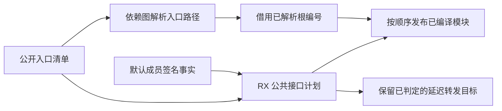
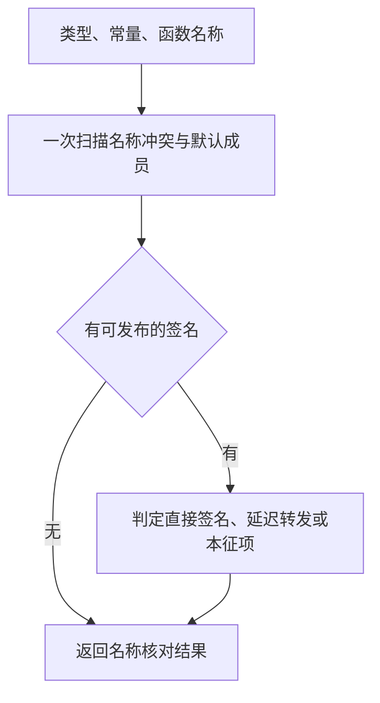

# 项目公开接口发布

## Intent

统一项目公开名称与默认重导出的决策，让混合项目发布复用依赖图已解析的模块编号。

## Data

混合项目以前在依赖图中查找公开入口，发布时再次解析路径并扫描所有模块。依赖图已按请求顺序保留根编号，发布可以直接索引已完成模块。ZX 项目与混合项目的公共名称都需要唯一性检查，混合项目另外拒绝空名称。默认重导出的签名结果用于后续 RX 引用解析。

## Edges

保持调用者顺序、重复名称诊断、源码路径归一化和默认重导出类型。延迟到 RX 解析的签名保留原路径引用。宿主负责汇集已借用名称和默认成员的事实，以及物化公开接口。

## Answer

核对 Source 自编译产物、既有跨模块及公开库回归，以及同清单的生成时间和峰值内存。整仓冷构建沿用固定基线。

以前一阶段的 Source 工具引导，三个新 Source 阶段均通过 22 步，11,010 份生成文件逐字节一致。性能专项使用两版各自的第三代 Source 工具执行 Source 分析与生成。共同清单为 558 个入口，排除语义已改变的公共接口计划入口。交替运行六轮，舍弃首轮后，墙钟中位数为 2.45 → 2.46 秒，CPU 为 11.05 → 11.09 秒，单进程峰值 RSS 为 886.82 → 866.12 MB。10,365 份共同产物逐字节一致。

64 项既有 Zig 回归、28 项路径与缓存 CLI 检查、59 项库发布检查通过。库发布使用本机同版本 Zig。首次展开内置 Zig 时两项发布检查返回 `WriteFailed`，清理已完成测量的本地构建缓存后，两项使用内置 Zig 复测均通过。另用既有 identity 源码确认两层 ZX 默认重导出到 RX 可生成且通过 `check-rx`，普通 ZX 默认重导出可生成，重复默认导出保留原诊断。

### 整仓冷构建

固定目录、Zig 0.17.0、ReleaseSmall、12 核、四分区和空本地及全局缓存。安装工具由 Native seed 引导，安装后执行 Source 分析与生成。最终独立运行通过全部 70 步。

| 指标                                           | 固定基线 | 上一阶段 |  本阶段 | 较上一阶段 | 较固定基线 |
| ---------------------------------------------- | -------: | -------: | ------: | ---------: | ---------: |
| 墙钟 / s                                       |   117.82 |   117.97 |  118.50 |      +0.53 |      +0.68 |
| CPU / s                                        |   207.44 |   211.98 |  211.10 |      −0.88 |      +3.66 |
| 进程树峰值 RSS / MB                            |  2328.74 |  2339.32 | 2381.92 |     +42.60 |     +53.18 |
| 四分区同时运行且无 Zig 检查时的树峰值 RSS / MB |  2327.00 |  2285.32 | 2297.59 |     +12.27 |     −29.41 |
| 单进程峰值 RSS / MB                            |  2088.58 |  2173.42 | 2142.08 |     −31.34 |     +53.50 |

三个 LLVM 分区对象与上一阶段逐字节一致，包含公开接口计划的分区对象增加 1,008 字节。总树峰出现在四个 LLVM 分区与 Zig 检查重叠的时段。同期单进程峰值和 Source 生成专项 RSS 均下降。CPU 的累计差异从 4.54 秒降至 3.66 秒，仍超过 3 秒警戒线。

项目装载栈与原生资源获取仍由 Zig 宿主驱动。下一阶段需继续收敛依赖装载状态与副作用边界。
