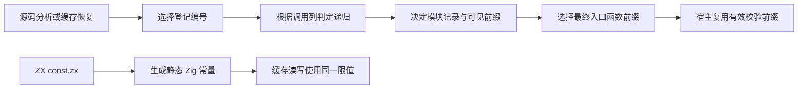
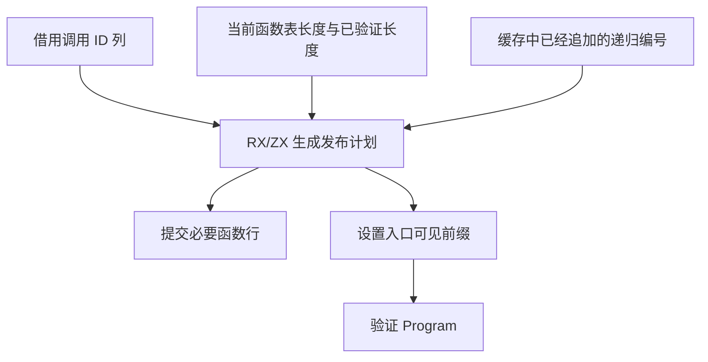

# 项目函数与入口发布

## Intent

把项目装载后的函数登记和入口发布迁入 RX/ZX，覆盖分析所得与缓存恢复所得的函数。补齐 ZX 常量到 Zig 的静态导出，让语义缓存读写直接引用同一份常量。

## Data

旧项目宿主分别判断是否追加函数、是否递归以及入口使用哪个函数表前缀。函数编号在注册前已由当前表长确定，已恢复递归函数持有先前登记的编号。Source IR 构造和缓存验证保证调用列与表达式中所有调用一一对应，因此递归判定可只遍历调用列。原有 RX 模块分类移至发布目录，函数登记直接调用它。

缓存工件的路径相等检查由 `validation/admit.rx` 调用既有的 `state/observe.zx`。`79297951` 已把检查并入准入流程并移除旧 Zig 转接，同时引入了仅返回常量的 `file_limit.zx`。本阶段让生成器把 IR 中已有的常量值打印成静态声明，并将导出常量纳入入口的生成缓存键。

## Edges

保持类型模块、默认重导出、递归缓存登记、Native seed 与所有权检查的原有行为。生成入口借用调用列，宿主负责函数存储、ABI 写入、前向调用的物化，以及将验证前缀裁到实际表长。静态常量输出复用 genz AST 与 printer，纯常量模块的 bootstrap 适配入口只暴露生成的静态常量。

## Answer

以源码、签名与独立库入口、递归及缓存回归为验收边界。

三代 Source 自编译各通过 22 步，两组相邻阶段各有 11,010 份生成文件逐字节一致。两版都使用各自由 Source 生成的第三代工具执行 Source 分析与生成。在共同清单上交替运行六轮并排除首轮，生成墙钟中位数为 2.40 → 2.41 秒，CPU 为 10.86 → 10.88 秒，峰值 RSS 为 871.30 → 856.44 MB，10,118 份共同产物逐字节一致。

安装版通过 5 项持久缓存和 9 项 RX 项目检查。157 模块函数、199 模块宽导入及 157 模块常量工程热命中耗时分别维持在 0.05、0.07 和 0.02 秒。递归函数和跨模块常量修改后，重新分析 2 个模块并复用 1 个，改回后生成文件恢复到原字节。恰好 64 MiB 和再大一字节的缓存文件均被丢弃并重建，产物一致。生成的 Zig 静态常量已在 `comptime` 验证整数、浮点、布尔、文本和枚举类型。

最终版另通过 99 项既有回归，覆盖语义缓存、缓存工件编解码、模块记录、跨模块类型和 36 项独立执行检查。双 Store 槽样例在进程内和从磁盘解码后各复用两个模块，生成的 1,608 字节 Zig 一致。

### 整仓冷构建

固定目录、Zig 0.17.0、ReleaseSmall、12 核、四分区，使用空本地及全局缓存。安装工具由 Native seed 引导，安装后运行 Source 分析和生成。最终候选独立运行通过全部 70 步。

| 指标                                           | 固定基线 | 上一阶段 |  本阶段 | 较上一阶段 | 较固定基线 |
| ---------------------------------------------- | -------: | -------: | ------: | ---------: | ---------: |
| 墙钟 / s                                       |   117.82 |   117.61 |  117.97 |      +0.36 |      +0.15 |
| CPU / s                                        |   207.44 |   210.70 |  211.98 |      +1.28 |      +4.54 |
| 进程树峰值 RSS / MB                            |  2328.74 |  2353.32 | 2339.32 |     −14.00 |     +10.58 |
| 四分区同时运行且无 Zig 检查时的树峰值 RSS / MB |  2327.00 |  2290.17 | 2285.32 |      −4.85 |     −41.68 |
| 单进程峰值 RSS / MB                            |  2088.58 |  2135.21 | 2173.42 |     +38.21 |     +84.84 |

与自编译重叠的候选构建为 135.40 秒墙钟、240.94 秒 CPU，四个分区对象与独立运行逐字节一致。独立运行较上一阶段的四个分区中有三个对象逐字节一致，变动分区增加 680 字节。采样中的四个 LLVM 分区合计 CPU 增加 0.70 秒，末段宿主 Zig 增加 0.18 秒。整次构建退休指令数约 5079.05 亿，略低于固定基线的 5079.07 亿。现有证据把冷构建 CPU 的差异主要定位到工具链构建阶段。Source 生成专项的 CPU 只增加 0.02 秒。固定基线累计 CPU 已超过 3 秒警戒，单进程峰值也继续上升，两项均需独立跟踪。

项目装载栈、签名与默认重导出物化仍由 Zig 驱动。生成器已能直接导出静态常量，常量的 Zig AST 构造仍是 Zig 宿主职责。
