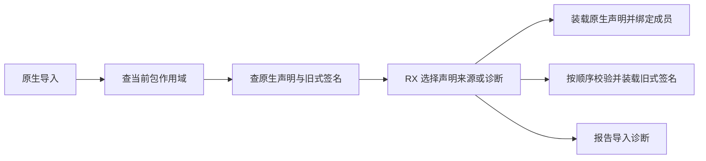
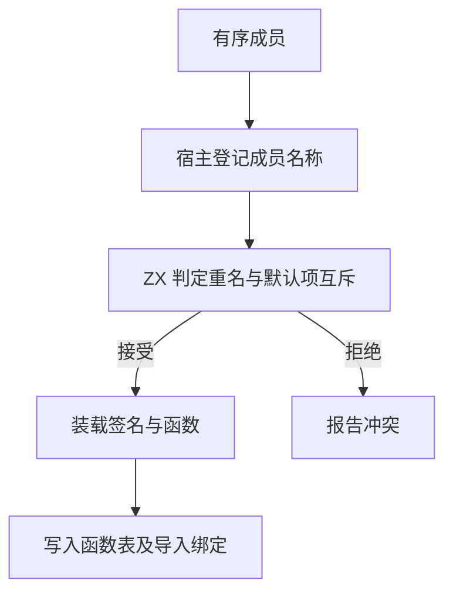

# 项目原生导入分派与成员绑定

## Intent

把项目原生导入的声明优先级、旧式外部签名回退和成员绑定规则迁入 RX/ZX，保留现有诊断顺序与函数编号。

## Data

同一次导入的两套注册表属于同一包，旧实现分别求其归属。处理旧式外部声明时，成员顺序会影响先报告哪处错误。函数分派使用原顺序，并把重名事实和当前成员交给 ZX 判定。原生接口及旧式声明的命名空间在同一次导入内相同，可以复用项目已拥有的文本。

## Edges

原生声明重名优先于旧式签名冲突，合法原生声明优先于旧式回退。旧式签名仍只接受一个默认导入绑定。成员冲突在装载当前声明前判断，保留前序声明先报错的行为。命名空间文字每次导入最多持有一份，原生注册表复用已拥有的身份字符串。函数体和绑定记录仍由 Zig 写入项目列，使用当前前缀及连续行号。旧式声明的重名表按单次导入释放。

## Answer

Source 三代自编译的生成产物有 11,037 份逐字节一致，每代 22 步成功。

两版 Source 工具对照 561 个共用入口，工具本体均由 Source 生成。六组交替运行排除首组，墙钟中位数均为 2.47 秒，CPU 11.08 → 11.07 秒，单进程峰值 RSS 中位数 863.19 → 905.02 MB。单轮样本区间分别为 862.09～925.12 MB 与 861.95～921.32 MB。共用入口的 10,391 份文件逐字节一致。

67 项现有原生声明和名义类型 Zig 回归通过，另有四项临时边界探针、20 项安装版集成通过。边界覆盖跨批次同名、包内原生声明与旧式签名冲突、默认与命名外部成员的互斥。

已有原生包在两个版本均首次写出源码工件和原生工件，第二次启动全部命中。冷、热、禁用缓存及两个版本之间的生成 Zig 一致。

整仓冷构建使用 Zig 0.17.0、ReleaseSmall、12 核、四分区和空本地及全局缓存。工具由 Native seed 引导，安装版执行 Source，70 步全部通过。

| 指标                                                     | 固定基线 | 上一阶段 |  本阶段 |
| -------------------------------------------------------- | -------: | -------: | ------: |
| 墙钟 / s                                                 |   117.82 |   118.10 |  119.00 |
| CPU / s                                                  |   207.44 |   211.06 |  212.66 |
| 进程树峰值 RSS / MB                                      |  2328.74 |  2304.36 | 2389.62 |
| 四个 LLVM 分区均在运行且无 Zig 检查进程时的树峰 RSS / MB |  2327.00 |  2304.36 | 2318.40 |
| 单进程峰值 RSS / MB（`time -l`）                         |  2088.58 |  2173.06 | 2163.56 |

相对上一阶段，墙钟多 0.90 秒，CPU 多 1.60 秒，单进程峰值减少 9.50 MB。采样树峰多 85.26 MB，本轮树峰时有约 458 MB 的 Zig 检查进程与 LLVM 四分区重叠。限定四分区均在运行且没有检查进程时，树峰多 14.04 MB。相对固定基线累计 CPU 多 5.22 秒，超过 3 秒警戒。四个 LLVM 分区对象净增 1,752 字节，两个逐字节一致。采样 LLVM CPU 合计 79.86 → 79.69 秒。固定输入 Source 生成中位数与整仓累计指标分别记录，累计差异尚未定位到具体代码。

构建、阶段对照与专项日志位于 `.zig-cache/cold-build-analysis/ownership-research/project-interface-routing/`。
