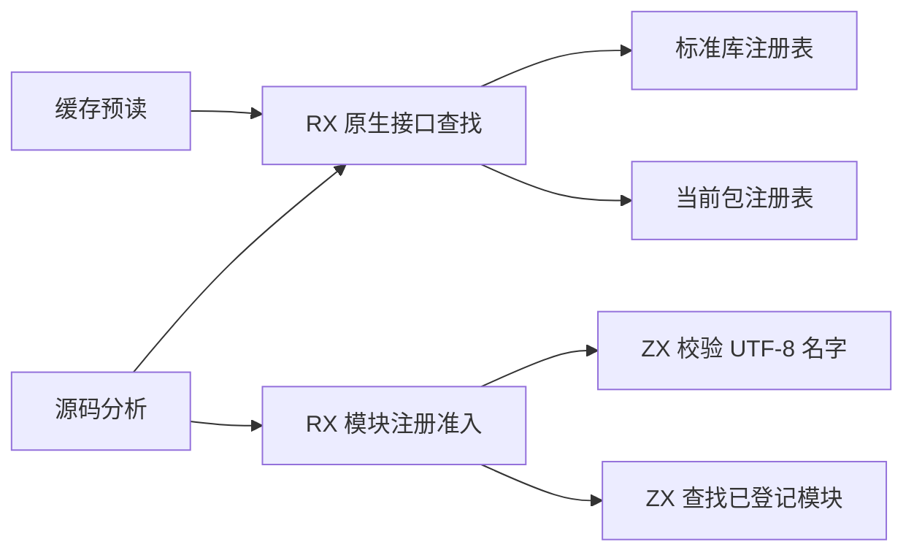
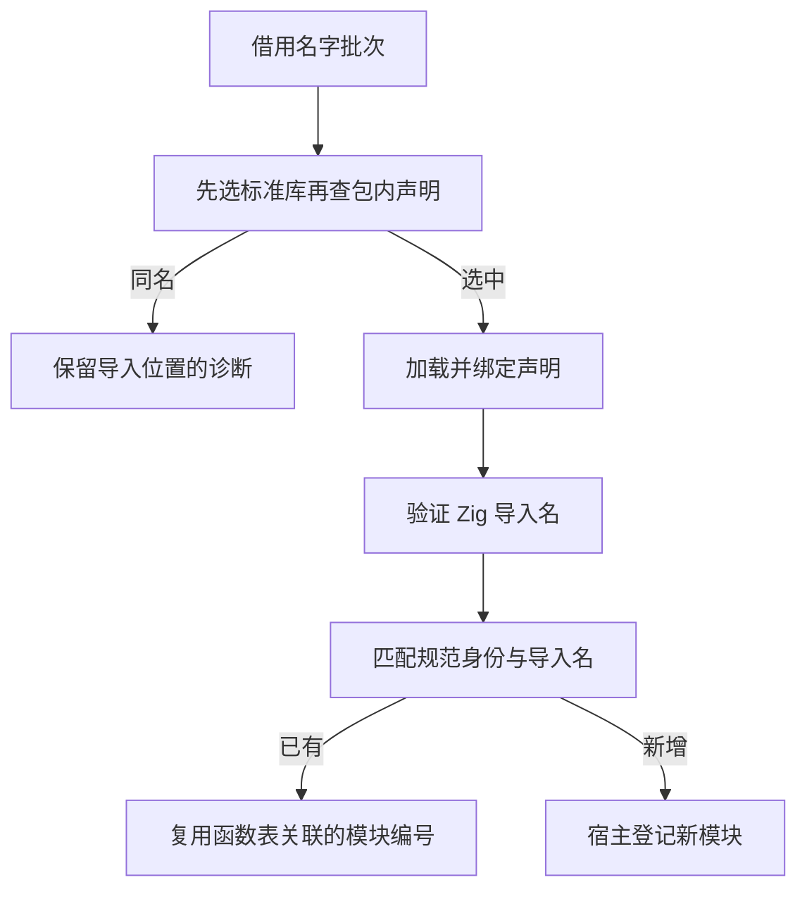

# 项目原生接口查找与注册

## Intent

把项目分析与语义缓存预读共用的原生接口优先级、重名处理及模块注册准入迁入 RX/ZX。

## Data

项目解析原生导入时先查标准库，再查当前包注册表。分析需要诊断同名声明，缓存预读只取第一个匹配。注册模块按规范身份与 Zig 导入名复用已有 IR 行。此前这些决策由 Zig 编排。

## Edges

标准库名字列在编译时生成，包内名字按固定容量借用批次传入。每次查找最多扫描一次标准库，匹配编号跨批次保留。准入流程借用 IR 模块表，不复制表内容。Zig 宿主负责读写物理表、登记失效和错误位置。旧 seed 保留同一套语义，旧式外部签名装载和原生函数体注册仍在 Zig。

## Answer

三代 Source 自编译各通过 22 步，11,027 份生成文件逐字节一致。固定 559 个共用入口，两版工具均由 Source 生成并执行 Source。六组交替运行排除首组后，墙钟中位数均为 2.44 秒，CPU 为 11.04 → 11.05 秒，采样工具进程峰值为 862.63 → 879.90 MB。10,375 份共同产物逐字节一致。

55 项原生声明、命名空间、成员与资源的现有 Zig 回归通过。另有两项跨批次探针和 20 项安装版 CLI 集成通过，覆盖标准库冲突、包作用域隔离、统一库重发布、ABI 别名和持久缓存。

使用已有原生包 fixture，两个版本都在首次生成写入一个源码工件和一个原生工件。第二次启动两者均命中，生成 Zig 与首次生成、禁用缓存及上一版一致。

整仓冷构建使用 Zig 0.17.0、ReleaseSmall、12 核、四分区及空本地和全局缓存。工具由 Native seed 引导，安装版执行 Source，构建通过 70 步。

| 指标                             | 固定基线 | 上一阶段 |  本阶段 |
| -------------------------------- | -------: | -------: | ------: |
| 墙钟 / s                         |   117.82 |   119.07 |  118.10 |
| CPU / s                          |   207.44 |   212.43 |  211.06 |
| 进程树峰值 RSS / MB              |  2328.74 |  2368.24 | 2304.36 |
| 单进程峰值 RSS / MB（`time -l`） |  2088.58 |  2160.49 | 2173.06 |

与上一阶段相比，墙钟减少 0.97 秒，CPU 减少 1.37 秒，进程树峰值减少 63.88 MB，单进程峰值增加 12.57 MB。四个 LLVM 分区对象合计增加 3,280 字节，其中一个逐字节一致。相对固定基线，累计 CPU 增加 3.62 秒，仍在警戒范围。

构建、阶段对照与专项日志位于 `.zig-cache/cold-build-analysis/ownership-research/project-native-registry/`。
