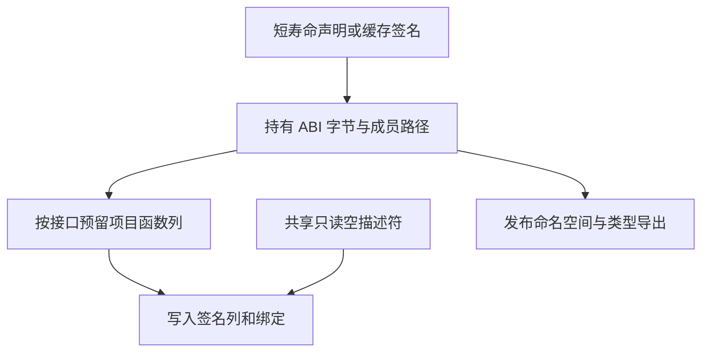

# 项目原生签名登记

## Intent

收口原生接口进入项目全局函数表的边界。原生模块槽位由 RX 编排校验、复用及编号选择。已分析的原生声明和缓存恢复使用同一个签名物化实现。

## Data

旧项目路径先在原生装载结果构造带空正文的完整函数，再拆回项目的列式函数表。四个空描述符按函数分配，登记按成员重复检查表容量。缓存恢复还重复持有同一组命名空间的字节。

新路径只传递签名和成员名，项目批量预留列容量，直接写入签名及成员绑定。空的符号、表达式、Store 及契约描述符由函数表共享，普通函数继续使用原有的独立描述符。原生模块描述符和成员路径借用同一份结果区持有的命名空间字节。

## Edges

模块原有行身份仍由规范化键与导入名确定。现有模块保留编号，新编号受函数表和模块表的 u32 容量限制。原生签名拥有源文件、名称、参数、错误集和命名空间数据，可脱离解析临时区与缓存条目存活。初始 seed 仍能把签名转换为完整函数验证。

## Answer

110 项 Zig 回归和 24 项安装版集成通过。回归中有一组遇到本地磁盘空间不足，清理已验收的临时自编译缓存后，只重跑受影响的组。另用临时探针核对共享空描述符的弹出与释放，以及原生缓存的复用、替换和数据生命周期。原生声明冷编、热命中、重排和还原的缓存负载及生成 Zig 与上一阶段逐项一致。三代 Source 自编译每代通过 22 步，11,108 个生成文件逐字节一致。

1,024 个原生函数的专项对照交替运行七次，峰值 RSS 中位数为 27.64 → 22.87 MB，CPU 中位数均为 0.05 秒，墙钟中位数为 0.05 → 0.06 秒。

完整冷构建使用 Zig 0.17.0、ReleaseSmall、12 核和四分区。编译器本体由 Native seed 引导，安装版运行 Source。四次记录均通过 70 步。

| 指标                 | 固定基线 | 上一阶段记录 | 同期控制 | 候选首轮 | 候选隔离复测 |
| -------------------- | -------: | -----------: | -------: | -------: | -----------: |
| 墙钟（秒）           |   117.82 |       112.58 |   112.63 |   113.91 |       114.65 |
| CPU（秒）            |   207.44 |       205.63 |   206.12 |   207.12 |       207.35 |
| 进程树峰值 RSS（MB） |  2328.74 |      2288.62 |  2329.31 |  2333.18 |      2384.58 |
| 单进程峰值 RSS（MB） |  2087.88 |      2153.35 |  2159.30 |  2158.66 |      2155.69 |

候选隔离复测比同期控制多 2.02 秒墙钟和 1.23 秒 CPU。三次使用相同缓存标识的 Zig 构建配置器，首次采样到配置器处理构建的时点分别是 28.79、30.01 和 30.25 秒。等到配置器开始处理任务后，两次候选分别比控制多约 0.06 和 0.56 秒。隔离复测比固定基线仍少 3.17 秒墙钟，CPU 少 0.09 秒。保留实际整轮差值，继续观察 CPU 是否向上累积。树峰较同期控制高 55.26 MB，单进程峰值低 3.61 MB。专项内存收益只适用于原生接口登记路径。

