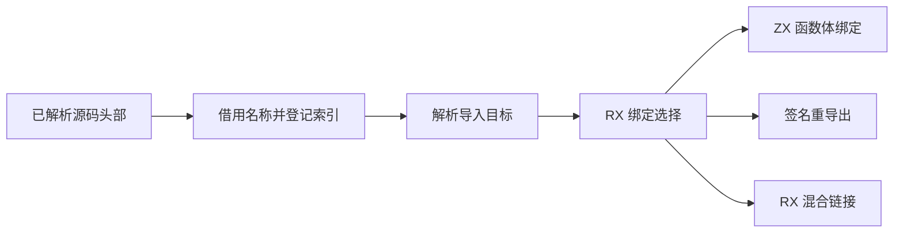
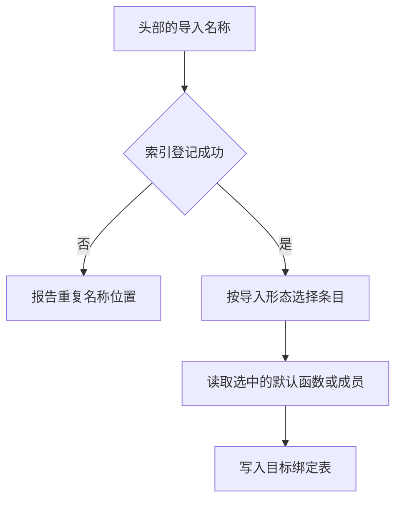

# 项目导入绑定登记与发布

## Intent

让项目导入复用 ZX 的字节索引登记绑定，统一函数体、签名分析和 RX 混合链接消费同一选择结果的方式。

## Data

项目装载帧用 Zig 字符串哈希表记录本地导入名。源码头部已经持有导入名称，索引只需要借用这些字节。RX 混合链接把默认函数和所有成员复制到临时列表。签名分析预先构造整张函数签名列表，实际只为重导出的成员读取签名。

## Edges

- 首次显式导入按源码头部已有的总槽位预留名称索引。解析结果必须存活至装载帧关闭。重导出不登记本地名称，依赖挂起后继续同一个导入时也不重复登记。
- 普通 ZX 绑定、签名绑定和混合链接共享默认函数与命名成员的借用视图。只将被选择的成员写入结果。签名阶段直接读取相应函数的 Store 列。
- 类型与常量的落表路径共用，保留常量字符串的结果所有权。纯类型导入只投影选择所需的列。
- 旧 Zig seed 继续实现相同的索引接口。生成后的编译器复用现有 ZX 字节索引。宿主仍负责帧生命周期、错误定位、名称文本保留和 IR 落表。

## Answer

41 项既有 Zig 回归通过，覆盖重复绑定、错误位置、分配失败、名义类型及原生库导入。32 项安装版集成通过，覆盖普通 ZX、混合 RX、Store 初始化器、已编译库和重新发布。

冷构建由 Native seed 引导，安装版执行 Source，使用 Zig 0.17.0、ReleaseSmall、12 核和四个 LLVM 分区，清空本地和全局缓存。70 步全部通过，四个分区对象与上一阶段逐字节一致。

| 指标                             | 固定基线 | 上一阶段 |  本阶段 |
| -------------------------------- | -------: | -------: | ------: |
| 墙钟 / s                         |   117.82 |   113.10 |  113.41 |
| CPU / s                          |   207.44 |   205.46 |  207.48 |
| 进程树峰值 RSS / MB              |  2328.74 |  2246.56 | 2336.60 |
| 单进程峰值 RSS / MB（`time -l`） |  2088.58 |  2160.89 | 2166.55 |

墙钟较上一阶段增加 0.31 秒，仍比固定基线少 4.41 秒。CPU 较上一阶段增加 2.02 秒，较固定基线增加 0.04 秒。采样中主组生成器 CPU 增加约 0.11 秒，编译检查进程增加约 0.71 秒。进程树峰值较固定基线增加 7.86 MB，峰值包含编译检查和四个分区重叠。去掉检查进程后，进程树峰值较固定基线少 2.19 MB。单进程峰值来自 Zig 宿主库编译。

以已验收的上一阶段 Source stage 3 为起点，连续三代各通过 22 步，排除工具身份文件后，11,041 份输出逐字节一致。第二、第三代首次构建遇到磁盘空间不足，留存已生成文件哈希和阶段产物并清理临时缓存后，分别从前一代继续。

两版均使用 Source 工具执行 Source。固定 564 个入口，交替运行六组空函数缓存，排除首组后，墙钟中位数 2.94 → 2.99 秒，CPU 11.38 → 11.34 秒，单进程峰值 RSS 862.40 → 866.76 MB。10,405 份主组输出逐字节一致。日志和校验表位于 `.zig-cache/cold-build-analysis/ownership-research/project-import-bindings/`。
