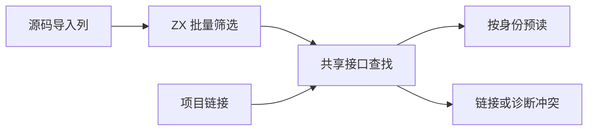
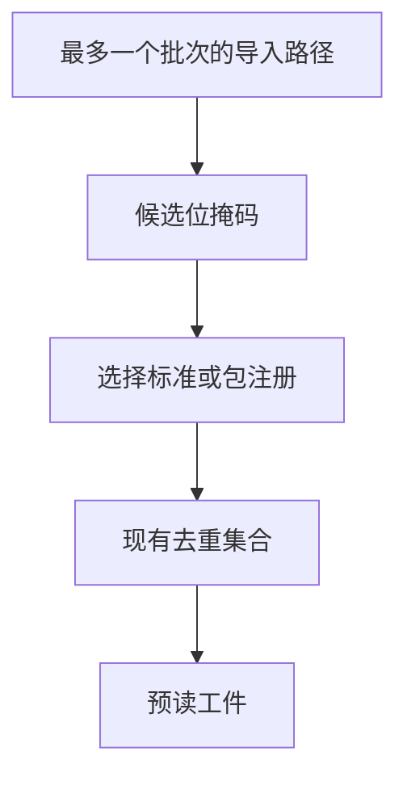

# 项目接口注册与缓存预读

## Intent

让项目链接和持久缓存预读共用 ZX 的接口注册查找，批量筛选需要预读的导入。保持注册优先顺序、冲突诊断和现有磁盘缓存协议。

## Data

缓存宿主曾逐条跨过生成入口分类，再分别扫描标准库和当前包的注册。项目链接另有一套注册扫描，需检测重复；包依赖与编译库实例也各自实现了相同的分批借用。

## Edges

- 保留首个匹配及重复状态，缓存继续按首个匹配预读，项目链接继续拒绝重复。标准库优先于包作用域注册。
- 每批最多 32 个导入，通过栈上切片描述符借用源文本和注册名。预读沿候选掩码从低位到高位消费，保持导入顺序。当前包的原生注册最多为每个含候选的文件解析一次。
- 已有 ZX 包和编译库实例查找也复用同一个分批适配。标准库的名称列在编译期构造。Native seed 保留原有查找算法。
- 文件 I/O、已有的哈希集合及结果发布继续由宿主处理。
- 一次性生成器在输出和输入快照写完后结束请求并释放发射 arena。持久缓存保存的是独立拥有的内容，清理之后才等待缓存写回。常驻服务继续保留可跨请求复用的发射容量。

## Answer

### 持久缓存专项

函数和常量两组 157 模块项目均完整命中。缓存文件名、上下文摘要及模块负载和上一版一致。修改或恢复一个函数体时各重新分析一个模块，修改或恢复一个导出常量时各重新分析两个模块，输出与禁用缓存的独立生成一致。五项既有 CLI 持久缓存检查及自递归导入常量的编辑恢复对照通过。

| 安装版专项                     |        墙钟 / s |         CPU / s | 单进程峰值 RSS / MB |
| ------------------------------ | --------------: | --------------: | ------------------: |
| 157 模块，函数项目首次生成     |     1.08 → 1.09 |     1.08 → 1.09 |       30.20 → 30.23 |
| 157 模块，函数项目持久恢复     |     0.53 → 0.54 |     0.53 → 0.53 |       16.66 → 16.71 |
| 157 模块，常量项目首次生成     |     0.42 → 0.42 |     0.41 → 0.41 |       22.04 → 22.02 |
| 157 模块，常量项目持久恢复     |     0.19 → 0.19 |     0.18 → 0.18 |       12.14 → 12.17 |
| 原生与源码闭包，每轮 24 次恢复 | 0.1184 → 0.1183 | 0.1185 → 0.1180 |                   — |

原生项目的 3 个源码工件、2 个原生工件和源码闭包项目的 8 个源码工件全部热命中。缓存关闭、热缓存以及两版之间的生成文件逐字节一致。

### 正确性

82 项既有缓存、工件、模块记录、库拒绝和原生配置回归通过。缓存、链接和原始原生产物通过 78 项 ABI 执行检查。源码闭包、原生模块和 Store 的 47 份库发布文件与上一版逐字节一致。独立探针覆盖 75 条导入和 41 条作用域注册，核对跨批边界、非法导入、同名冲突和标准库优先顺序。安装版暖缓存构建通过 70 步，整仓无修改热构建尚无同口径计时。

最终冷构建的安装版通过 4 项多包原生接口和 10 项 ABI 别名集成测试。重新验证了源码闭包与原生工件热命中、禁用缓存的生成等价性，以及 47 份库发布文件的字节一致性。

### 整仓冷构建

同一隔离源码目录、Zig 0.17.0、ReleaseSmall、12 核、四分区、空本地和全局缓存，关闭常驻生成。工具由 Native seed 引导，安装版执行 Source。各轮都通过 70 步。

| 指标                             | 上一版 `c4dfffed` | 候选首次 | 候选复测 |
| -------------------------------- | ----------------: | -------: | -------: |
| 墙钟 / s                         |            117.03 |   118.46 |   118.21 |
| 总 CPU / s                       |            209.18 |   209.54 |   209.88 |
| 进程树峰值 RSS / MB              |          2,351.38 | 2,311.63 | 2,359.21 |
| 单进程峰值 RSS / MB（`time -l`） |          2,163.08 | 2,162.85 | 2,143.80 |
| LLVM 分区合计峰值 RSS / MB       |          2,286.37 | 2,260.45 | 2,252.98 |

候选相对上一版的墙钟增加 1.43、1.18 秒，两轮均超出 1 秒的单阶段阈值。相对固定同目录基线 117.82 秒墙钟、207.44 秒 CPU，两轮累计墙钟分别增加 0.64、0.39 秒，CPU 增加 2.10、2.44 秒。两轮候选的四个分区对象逐字节一致。树峰落在 LLVM 分区和 Zig 检查重叠时刻，LLVM 分区的合计峰值两轮都较低。

进程采样显示，最早三轮的 Zig 构建配置器编译分别在第 29.21、30.49、29.77 秒首次出现。配置器开始之后的墙钟分别为 87.82、87.97、88.44 秒。首轮增加的 1.43 秒中，约 1.28 秒出现在配置器启动前。

随后同步隔离源码中的 10 份历史排版差异，对 11,134 份已跟踪构建和源码输入及 3 份新增文件核对摘要，确保同期对照只差本批的 10 份实现文件。上一版和注册候选分别为 117.84 和 115.88 秒，CPU 210.28 和 209.66 秒，进程树峰值 2,355.68 和 2,331.92 MB。候选的四个 LLVM 分区对象与前两次候选一致。两轮配置器分别在 29.93 和 27.83 秒开始，之后分别耗时 87.91 和 88.05 秒。这组对照把主要变化缩小到 Zig 启动配置器之前。由于该前置差异，整轮少 1.96 秒不归因于注册查找改动。

加入一次性生成器的输出内存释放后，最终整仓冷构建通过 70 步。四个 LLVM 分区对象与注册候选逐字节一致。

| 指标                             | 同期上一版 |   最终版 |
| -------------------------------- | ---------: | -------: |
| 墙钟 / s                         |     117.84 |   116.25 |
| 总 CPU / s                       |     210.28 |   209.73 |
| 进程树峰值 RSS / MB              |   2,355.68 | 2,285.34 |
| 单进程峰值 RSS / MB（`time -l`） |   2,155.94 | 2,150.65 |
| LLVM 分区合计峰值 RSS / MB       |   2,279.21 | 2,261.35 |

相对固定同目录基线 117.82 秒墙钟、207.44 秒 CPU，最终版墙钟减少 1.57 秒、CPU 累计增加 2.29 秒。最终版的进程树峰值没有与 Zig 检查进程重叠，整树减少量包含进程调度差异。与日终样本 117.03 秒和 209.18 秒对照，墙钟减少 0.78 秒、CPU 增加 0.55 秒。

### Source 自编译

以上一版 Source stage 3 引导，使用 Zig 0.17.0、ReleaseSmall、12 核和 16 分区。三代各通过 22 步。第 3 代首次遇到磁盘空间不足，清理已留存指标和校验值的重复冷构建缓存后，从第 2 代产物继续。排除工具身份文件后，两组相邻阶段各有 10,977 份生成文件逐字节一致。

两版工具各由自己的 Source stage 2 生成，运行使用 Source。在同一份源码和 556 个公共入口上交替六轮，舍弃首轮，函数缓存和输出目录从空开始。墙钟中位数均为 2.51 秒，CPU 从 11.11 降至 11.06 秒，单进程峰值 RSS 从 861.39 升至 871.12 MB。10,257 份主组产物逐字节一致。

随后通过 macOS 进程采样区分推导与发射、输出写入、发布后收尾。采样的物理占用中位数分别为 813.63 → 813.94 MB、821.51 → 821.22 MB、822.71 → 823.30 MB。候选有三轮在发布后短时达到 832～833 MB。发布结束后，输出 arena 在一次性进程里继续与函数缓存写回和所有权备忘录序列化并存。

使用同一 Source stage 2 重新构建提前释放输出的生成器，22 步通过。对改动前后的候选生成器再次在 556 个入口上交替六轮并舍弃首轮。墙钟中位数均为 2.47 秒，CPU 11.02 → 11.06 秒，单进程峰值 RSS 862.24 → 860.85 MB，10,257 份主组输出逐字节一致。常驻进程的请求复用保持原有行为。

以包含提前释放改动的工具再构建下一代，22 步通过。原注册候选的第 3 代、使用相同引导输入构建的最终工具，以及最终工具构建的下一代，生成输出在相邻两组各有 10,977 份文件逐字节一致。

注册记录的物理存储、候选掩码的遍历、磁盘预读去重和 I/O 仍在 Zig。专项记录在 `.zig-cache/cold-build-analysis/ownership-research/project-interface-registry/`。同期对照及最终冷构建的采样和构建日志位于同一隔离目录的 `cold-project-interface-registry-control`、`cold-project-interface-registry-paired` 和 `cold-project-interface-registry-final`。
