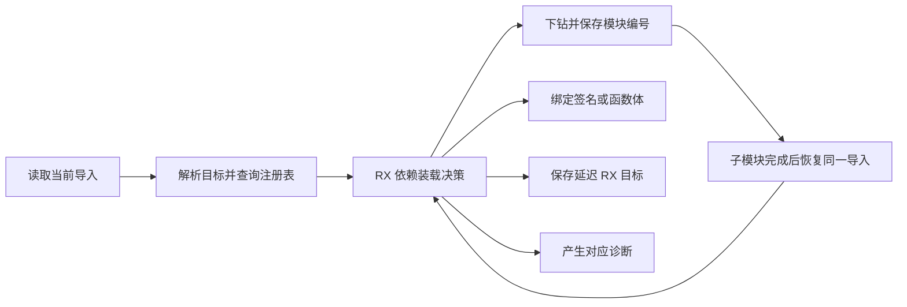
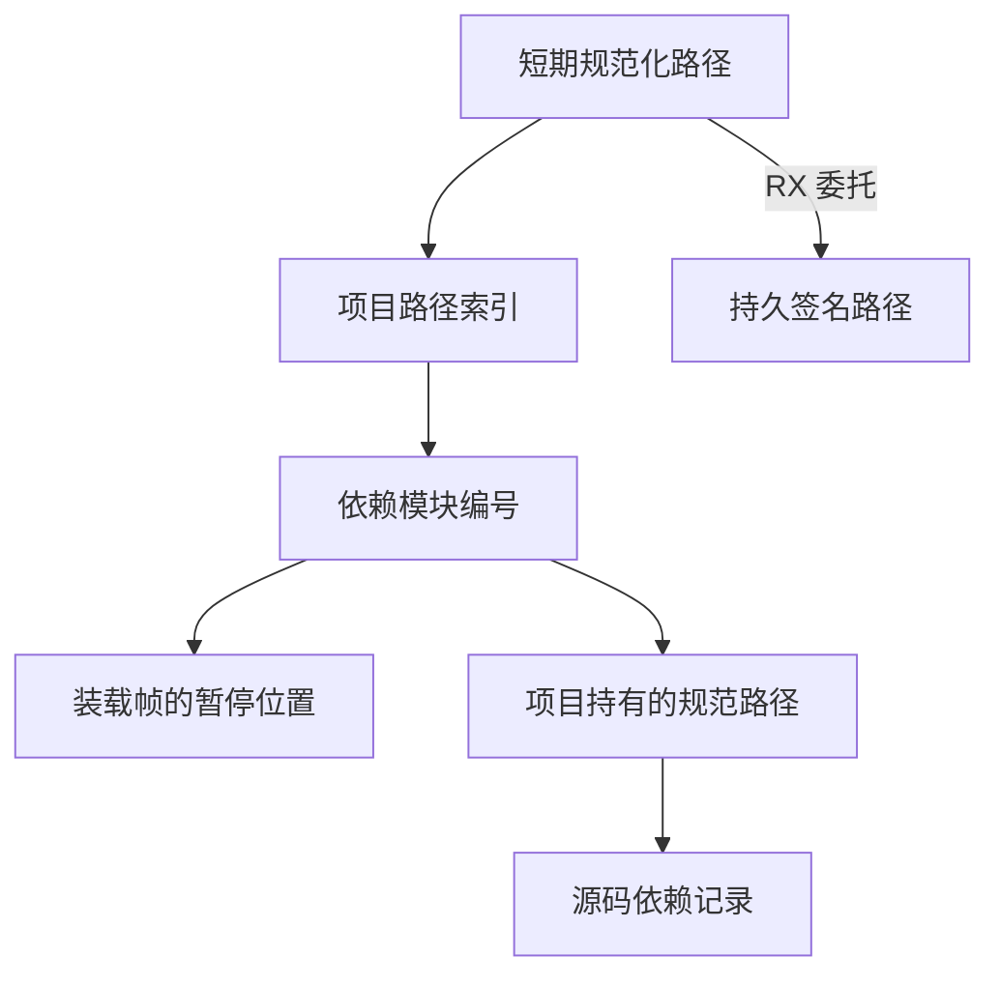

# 项目源码依赖装载

## Intent

用 RX 表达源码依赖装载的分支，按现有深度优先顺序处理 ZX 源码、RX 签名委托与诊断，同时缩短导入路径的生命周期。

## Data

项目已按规范路径登记全部 ZX 模块，并在访问中维护 Fresh、Visiting、Done 状态。旧的源码路由只返回是否允许 RX，依赖是否缺失、是否下钻以及选择签名还是函数体仍由 Zig 决定。导入路径解析分配在项目 arena，常规 ZX 依赖可直接复用已经登记的同一路径。旧帧同时保存待处理依赖的路径和编号。

## Edges

本地源码和已编译库共用短期路径工作区。暂停帧只保留模块编号，记录中的源码目标直接借用项目 arena 内的规范路径。需跨迭代保存的延迟 RX 路径、已编译库目标和工件抽取后的路径由各自的生命周期持有。路径规范化、循环和深度诊断、签名委托的优先级沿用既有语义。

## Answer

以安装版的目录导入、循环、签名委托、缓存恢复和分配失败回归验收。比较相同清单的 Source 生成产物、内存和 CPU，整仓冷构建沿用固定配置。

三代 Source 自编译各通过 22 步，相邻两代之间的 11,011 份文件逐字节一致。两版由 Source 生成的第三代工具执行同清单的 Source 分析与生成。清单排除接口已变动的装载决策和上一阶段用于隔离差异的公共接口计划。六组交替运行排除首组后，中位数墙钟 2.46 → 2.43 秒，CPU 11.10 → 11.03 秒，峰值 RSS 895.04 → 898.68 MB。10,361 份共同产物逐字节一致。

安装版在路径长度超过栈内缓冲区时仍可解析依赖并命中两个语义缓存条目。依赖深度 256 可编译，257 触发原深度诊断。两层 ZX 默认重导出到 RX 通过生成与 `check-rx`。普通 ZX 默认重导出和重复默认导出诊断也完成检查。

157 模块函数、199 模块宽导入和 157 模块常量工程的热缓存墙钟中位数保持 0.05、0.07、0.02 秒。两版缓存内容、路径和上下文摘要一致，编辑与恢复结果均与对应冷生成一致。递归缓存用例修改和恢复时各重分析两个模块、复用一个，生成输出一致。

110 项既有 Zig 检查通过，含 36 项独立执行检查。87 项安装版 CLI 检查通过，覆盖持久缓存、ZX 导入路径、RX 项目和统一库发布。

复核中发现，单独将默认重导出文件作为纯 ZX 项目的入口时，启用语义缓存会报告工件提取失败，关闭缓存可以生成。上一阶段安装版也能复现，该问题涉及工件入口和函数表前缀的处理，留待独立修正。

### 整仓冷构建

固定目录、Zig 0.17.0、ReleaseSmall、12 核、四分区、空本地及全局缓存。工具由 Native seed 引导，安装版执行 Source。70 步全部通过。

| 指标                                           | 固定基线 | 上一阶段 |  本阶段 | 较上一阶段 | 较固定基线 |
| ---------------------------------------------- | -------: | -------: | ------: | ---------: | ---------: |
| 墙钟 / s                                       |   117.82 |   118.50 |  118.41 |      −0.09 |      +0.59 |
| CPU / s                                        |   207.44 |   211.10 |  211.43 |      +0.33 |      +3.99 |
| 进程树峰值 RSS / MB                            |  2328.74 |  2381.92 | 2380.12 |      −1.80 |     +51.38 |
| 四分区同时运行且无 Zig 检查时的树峰值 RSS / MB |  2327.00 |  2297.59 | 2221.87 |     −75.72 |    −105.13 |
| 单进程峰值 RSS / MB                            |  2088.58 |  2142.08 | 2157.23 |     +15.15 |     +68.65 |

三个 LLVM 分区对象和上一阶段逐字节一致，第四个增加 304 字节。采样中的四分区 CPU 合计减少 0.75 秒，末段 Zig 宿主 CPU 增加 0.46 秒。整仓累计 CPU 仍超出 3 秒警戒。当前源码装载规则由 RX 决定，遍历循环、物理栈与原生依赖获取仍在 Zig。
