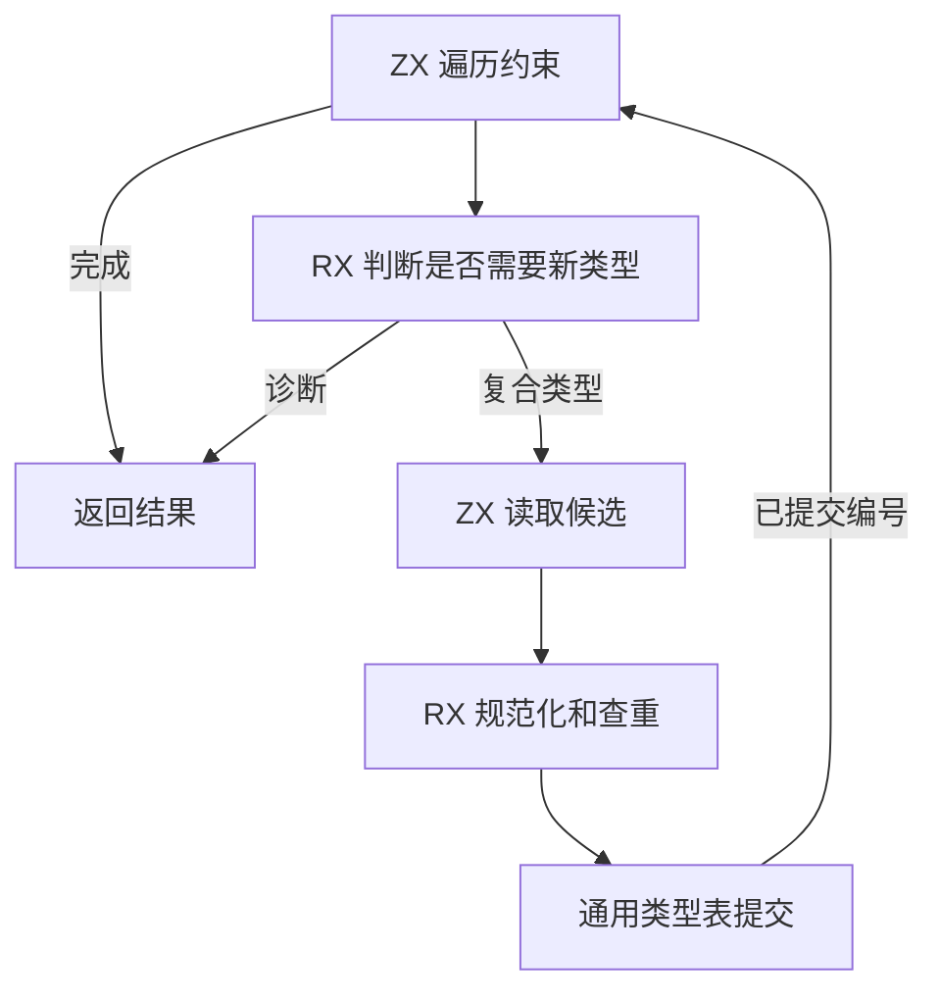

# RX 推导类型接续与发布

## Intent

将 RX 类型推导的复合类型接续迁入 RX/ZX。宿主在记录写入通用类型表后将编号交回遍历器。

## Data

遍历器以工作区、起点和数量标记子类型区间。ZX 从这段区间借用记录，RX 决定返回诊断还是调用已有的规范化、校验和查重流程。宿主只恢复约束对象中已有字段名的借用描述符，并提交类型表更新。生成的候选构造函数通过 Zig 切片表达式借用子类型数据，未分配或复制子类型数组。

## Edges

沿用遍历深度、字段顺序、诊断位置与编号分配。查重、验证和发布每次处理一个候选，记录成功登记之后才发布图节点的类型编号。临时规范化结果在本次接续后释放。初始 seed 继续使用递归入口，类型表的存储与约束字段列的布局在 Zig 宿主处理。

## Answer

三代 Source 自编译各通过 22 步，两组相邻代各有 11,269 个生成文件逐字节一致。安装版对照覆盖嵌套对象和数组、重复复合类型、空对象、可空类型与元组，以及无约束输入的诊断。

普通推导套件中三项既有分配失败用例指向混合项目的导出收尾。该路径在空导出时仍然预热 arena，并忽略预热失败。空导出现在直接返回，实际导出时传播分配失败。修改后 15 项分配失败回归全部通过。

普通 RX 推导 138 项、并行推导 105 项、RX 依赖图 2 项、库分配与生命周期 5 项以及安装版集成 47 项通过。常驻生成器对照了 274 模块项目的正文编辑、还原和导入变更。候选和上一版每步重分析的模块数一致，生成内容与独立冷生成一致。

整仓使用 Zig 0.17.0、ReleaseSmall、12 核、四个 LLVM 分区及独立空缓存。Native seed 引导安装版，安装版启用 Source 分析和生成。完整冷构建通过 70 步。

| 样本             | 墙钟（秒） | CPU（秒） | 进程树峰值（MB） | 单进程峰值（MB） |
| ---------------- | ---------: | --------: | ---------------: | ---------------: |
| 固定基线         |     117.82 |    207.44 |          2328.74 |          2087.88 |
| 上一阶段历史样本 |     111.04 |    204.28 |          2385.38 |          2141.93 |
| 上一提交同期复测 |     112.03 |    205.82 |          2354.92 |          2131.33 |
| 本阶段           |     113.12 |    206.02 |          2357.87 |          2127.56 |

本阶段墙钟较同期对照增加 1.09 秒，主生成器启动前已出现约 0.78 秒差异。上一提交的两轮独立测量相差 0.99 秒，四个 LLVM 分区目标文件逐字节一致。两版第三代 Source 工具直接生成同一份完整清单的配对测量中，生成墙钟中位数从 2.395 降至 2.370 秒，CPU 从 9.845 降至 9.810 秒，类型分析从 1,010.5 降至 1,002.5 ms。同期进程树峰值增加 2.95 MB，单进程峰值减少 3.77 MB。相对固定基线，墙钟减少 4.70 秒，CPU 减少 1.42 秒，进程树和单进程峰值分别增加 29.13 MB 和 39.68 MB。
