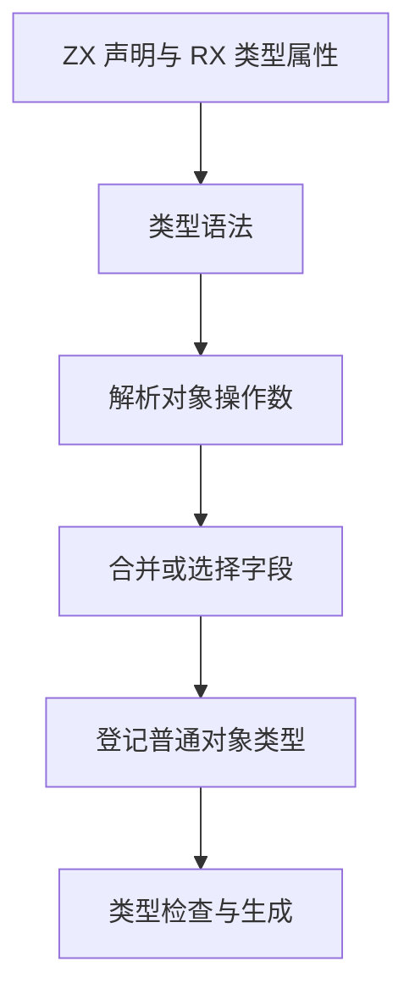

# ZX 对象类型复用

## Intent

支持对象类型交叉、`.Pick()` 和 `.Omit()`。用已有名义或结构化类型作为字段定义的来源，在仓库内合并重复声明。

## Data

ZX 已有对象类型规范化及类型编号复用。源码解析器分别有初始 Zig seed 与 Source 实现。类型操作沿用现有的对象类型表示，保留所选字段的类型编号和可空性。

## Edges

`&` 仅用于对象。相同类型的同名字段合并，类型不一致时在交叉位置报告诊断。`.Pick()` 选择指定字段，`.Omit()` 排除指定字段。参数是静态字符串，拒绝未知和重复字段。三种操作在编译期消解。现有 enum 继续表达有限选项。

原生 Zig 模块的 `.d.zx` 参数仍通过显式字段声明映射本地 ABI 名称。

## Answer

复用编译器和生成器中的 41 处类型声明。每处对照原始字段名、类型和可空标记。安装版通过 ZX 类型组合、RX `Type` 与 `Args`、错误诊断和格式化检查。显式声明与等价类型运算生成的 Zig 逐字节一致。全部 65 个修改的 ZX 文件通过 lint。

类型解析和语义解析回归通过 89 项。三代 Source 自编译各通过 22 步，两组相邻代各有 11,272 个生成文件逐字节一致。

使用 Zig 0.17.0、ReleaseSmall、12 核、四个 LLVM 分区及独立空缓存。Native seed 引导安装版，安装版启用 Source 分析和生成。完整冷构建通过 70 步。

| 样本     | 墙钟（秒） | CPU（秒） | 进程树峰值（MB） | 单进程峰值（MB） |
| -------- | ---------: | --------: | ---------------: | ---------------: |
| 固定基线 |     117.82 |    207.44 |          2328.74 |          2087.88 |
| 上一阶段 |     113.35 |    203.40 |          2385.46 |          2142.65 |
| 本阶段   |     111.04 |    204.28 |          2385.38 |          2141.93 |

较上一阶段，墙钟减少 2.31 秒，CPU 增加 0.88 秒，进程树峰值减少 0.08 MB。较固定基线，墙钟减少 6.78 秒，CPU 减少 3.16 秒，进程树与单进程峰值分别增加 56.64 MB 和 54.05 MB。主生成器分析时间持平，生成减少 8 ms，写出增加 57 ms。
