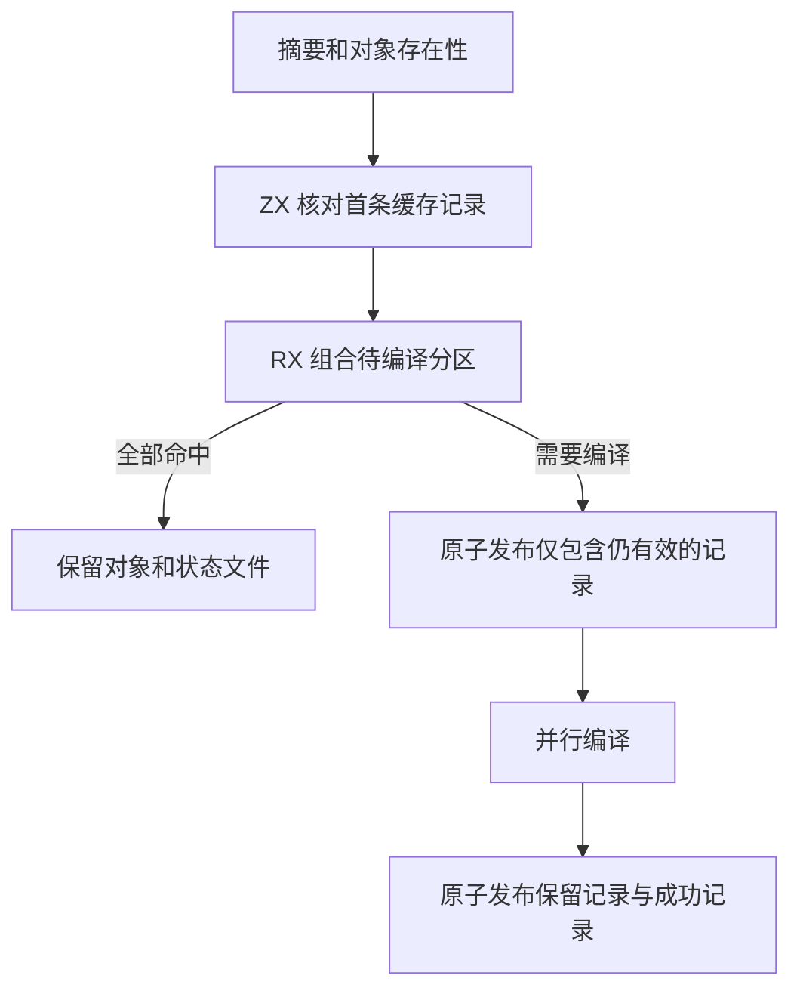

# 分区对象缓存状态自举

## Intent

将分区对象缓存的状态解码、失效选择和发布迁入 RX/ZX，保持已有缓存格式，修复构建中断后旧摘要可能指向已替换对象的问题。

## Data

旧工具按待检查分区反复扫描状态文件，编译后又用线性搜索核对结果。新工具单次遍历状态文本，按分区编号登记首条记录。RX 把摘要核对与对象存在性检查组合为待编译列表。宿主记录实际编译结果，ZX 按编号输出有效记录。

## Edges

摘要保持小写十六进制，编号保持十进制，重复编号由首条记录决定。全命中保留状态文件的字节及时间戳。失败或中断时，未成功发布的分区没有有效记录，恢复旧输入仍会重编该分区。Zig 宿主负责进程调度、文件存在性检查、通用数值格式化和原子替换。该阶段处理单次构建的发布顺序，验证覆盖进程终止。

## Answer

兼容旧记录的对照覆盖重复或无效编号、末行无换行、对象缺失、只重编失效分区、编译失败后恢复，以及终止正在替换对象的构建后恢复旧输入。对同一份 16 分区生成树交替运行两版工具，各去除首轮后九次全命中的墙钟中位数从 7.90 ms 降至 7.75 ms，峰值 RSS 中位数均为 4.28 MB。新版保留命中的状态文件和对象时间戳。

三个 Source 阶段各通过 22 步，11,380 个生成文件逐字节一致。主生成树、集合、增长和顺序分析四组与上一提交一致。独立 host 组有 15 个文件新增或变化。

解析缓存与 RX 依赖图的 16 项 Zig 回归通过，安装版持久缓存和应用 watch 的 6 项检查通过。新增 RX/ZX 文件全部通过格式和 lint 检查。

整仓冷构建使用 Zig 0.17.0、ReleaseSmall、12 核、四个 LLVM 分区及独立空缓存。Native seed 生成安装版，安装版使用 Source 分析及生成。两次同期构建均通过 70 步，四个 LLVM 分区对象逐字节一致。

| 样本             | 墙钟（秒） | CPU（秒） | 进程树峰值（MB） | 单进程峰值（MB） |
| ---------------- | ---------: | --------: | ---------------: | ---------------: |
| 固定基线         |     117.82 |    207.44 |          2328.74 |          2087.88 |
| 上一阶段留存样本 |     112.25 |    205.88 |          2348.02 |          2137.52 |
| 上一阶段同期对照 |     113.50 |    205.49 |          2302.67 |          2132.02 |
| 本阶段           |     112.67 |    205.75 |          2278.67 |          2147.78 |

较同期对照，墙钟减少 0.83 秒，CPU 增加 0.26 秒，进程树峰值下降 24.00 MB。单进程峰值增加 15.76 MB，发生在未改动的 Zig 静态库构建。较固定基线，墙钟减少 5.15 秒，CPU 减少 1.69 秒，进程树峰值下降 50.07 MB，单进程峰值增加 59.90 MB。缓存工具在冷构建采样中约占 4.7 MB，LLVM 分区对象一致，因此整树变化不计为缓存工具自身收益。

首次候选测量为 126.95 秒、CPU 224.08 秒。该次有后台磁盘目录扫描，多个未修改编译步骤也同步变慢。关闭扫描后，用同一个源码快照和工具链分别重建旧版与新版。上表采用隔离后的同期结果，并保留首次样本供核对。
