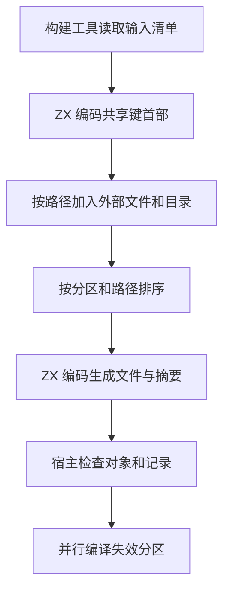

# 分区对象缓存键自举

## Intent

迁移构建期分区对象的缓存键编码，保持已有对象的失效范围，限制读取外部输入时的临时内存。

## Data

对上一阶段的同期构建取样，分区 0 的生成文件和目标文件完全相同，但分区进程峰值分别为 905.2 MB 和 970.2 MB。另外三处分区发生了成员变动，各自的生成源码总量变化 2.3 至 11.3 KB。现有采样可证明确定性产物与单进程峰值波动同时存在，尚不能把此前整树差异完整归因于源码分配。

## Edges

宿主保留文件遍历、排序、标准 Blake3、进程调用和构建状态发布。分区的 ZX 编码通过已独立生成的 host 模块链接到构建工具，编译对象时无需依赖分区本身。外部文件按最初长度分块读入，读取前后核对长度。路径排序时携带摘要，消除分区成员编码阶段的第二次哈希表查询。

## Answer

旧版生成的缓存记录可被新版直接使用。验证覆盖跨批次的 133 个分区成员、大文件、空文件、单分区失效、分区编译失败及恢复、删除分区对象后重建和外部输入更新。

同一份 16 分区编译器输出交替运行两版缓存工具。各舍去首轮后，九次全命中的耗时中位数为 8.09 ms 和 7.89 ms，峰值 RSS 中位数从 5.47 MB 到 4.28 MB。缓存记录字节和各分区目标文件的修改时间保持一致。

三代 Source 自编译各通过 22 步，相邻阶段 11,368 个生成文件逐字节一致。与上一阶段相比，主生成树、集合、增长和顺序分析四组生成文件完全一致，变更集中在独立 host 生成物。

解析缓存及 RX 依赖图的 16 项 Zig 回归通过，安装版的持久缓存和应用 watch 通过 6 项检查。

整仓冷构建使用 Zig 0.17.0、ReleaseSmall、12 核、四个 LLVM 分区及独立空缓存。Native seed 引导安装版，安装版启用 Source 分析和生成。70 步通过，四个 LLVM 分区对象与上一阶段逐字节一致。

| 样本     | 墙钟（秒） | CPU（秒） | 进程树峰值（MB） | 单进程峰值（MB） |
| -------- | ---------: | --------: | ---------------: | ---------------: |
| 固定基线 |     117.82 |    207.44 |          2328.74 |          2087.88 |
| 上一阶段 |     111.95 |    204.90 |          2418.56 |          2123.76 |
| 本阶段   |     112.25 |    205.88 |          2348.02 |          2137.52 |

较上一阶段墙钟增加 0.30 秒，CPU 增加 0.98 秒。较固定基线，墙钟和 CPU 仍分别少 5.57 秒和 1.56 秒。进程树峰值下降 70.53 MB，单进程峰值增加 13.76 MB。四个 LLVM 分区采样合计峰值从 2,342.58 MB 到 2,281.64 MB，接近上一阶段同期对照的 2,274.12 MB。此变化发生在分区对象内容相同的样本之间，不能归为缓存工具流式读取的收益。
