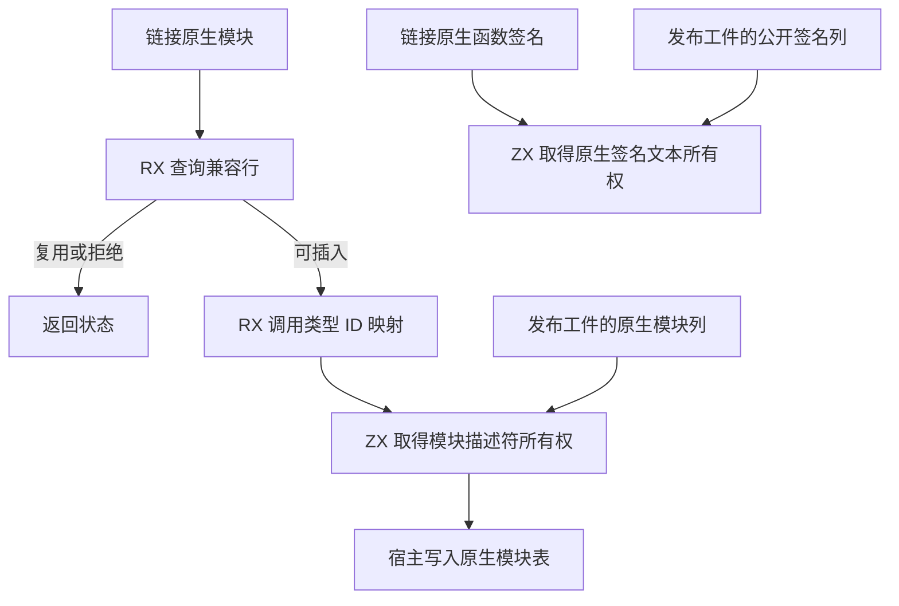

# 工件原生描述符所有权

## Intent

将 Source 工件库链接和发布阶段的原生描述符所有权归入 RX/ZX。原生模块标识、类型名称、函数路径成员、错误名称和参数名称在输入工件释放后仍须有效。

## Data

此前 `link/native/bind.rx` 完成类型映射和插入判定，Zig 在插入时复制模块文本。函数的原生签名由 `Nodes.externalMapped` 复制，工件导出的签名列在 ZX 中执行相同的复制。四条路径共用底层的名称和可空名称复制方式。

## Edges

Source 宿主通过 `executeValue` 转换描述符，保留未变的 ABI 标志，使用 ZX 产出的文本和类型 ID。现有 Native seed 保留引导所需的实现。函数正文未变标量列仍由宿主按原长度分配和复制，现有 `concat` 会额外预留容量，用它替换会改变这条热路径的成本模型。

## Answer

验收覆盖原生模块复用、ABI 冲突、源工件销毁后的独立生命周期、分配失败、缓存恢复和安装版库发布。三代 Source 产物在相同输入下对齐；整仓冷构建沿用固定基线和上一阶段口径。

38 项定向 Zig 回归和 47 项安装版检查通过，六组导入诊断或产物与上一版一致。以上一阶段的第 3 代 Source 工具引导本轮，三代 Source 自编译均通过 22 步。两组相邻代各有 11,170 份生成产物逐字节一致。检查生成 Zig 的 `executeValue` 调用，进入宿主的复用及拒绝结果只携带状态，插入产出的字节由目标 allocator 持有。

整仓冷构建使用 Zig 0.17.0、ReleaseSmall、12 个并发槽和四个 LLVM 分区。工具由 Native seed 引导，安装版运行 Source。本轮核对 11,212 个构建输入。

| 版本                    | 墙钟（秒） | CPU（秒） | 树峰值 RSS（MB） | 单进程峰值 RSS（MB） |
| ----------------------- | ---------: | --------: | ---------------: | -------------------: |
| 固定基线                |     117.82 |    207.44 |         2,328.74 |             2,087.88 |
| 上一阶段记录 `a1335221` |     111.83 |    204.38 |         2,395.77 |             2,153.53 |
| 上一阶段同期对照        |     112.94 |    204.86 |         2,326.53 |             2,157.92 |
| 本轮首次                |     121.29 |    212.81 |         2,310.03 |             2,155.25 |
| 本轮复测                |     117.69 |    209.62 |         2,336.60 |             2,146.50 |
| 清理旧构建缓存后        |     113.44 |    204.24 |         2,390.02 |             2,156.66 |

两轮候选的四个 LLVM 分区对象逐字节一致。首次 `generate-parser` 和 `translate-c` 均比对照多约 3 秒，复测回到对照水平。复测生成输出的写入耗时 1.54 秒，对照为 0.43 秒。四个分区的采样墙钟同步增加约 1.7 至 1.9 秒，其中两个对象与上一版逐字节一致。安装版的原生缓存重复测试中，每批 12 次热恢复的中位墙钟为 0.0532 → 0.0533 秒，中位 CPU 为 0.0524 → 0.0523 秒。冷编译与缓存复用生成产物一致，均保留两个原生缓存命中。

清理可重建的旧缓存后，候选由 2.4 GiB 可用空间起跑，生成输出写入恢复到 0.31 秒。最终比同期对照多 0.50 秒墙钟、少 0.62 秒 CPU，比固定基线少 4.38 秒墙钟和 3.20 秒 CPU。三轮候选的四个 LLVM 分区对象逐字节一致。

进程树峰值较上一阶段记录低 5.75 MB，较同期对照高 63.49 MB。最终候选的树峰与 461.75 MB 的 Zig 测试编译重叠，且 LLVM 分区合计峰值比同期对照低 15.30 MB。单进程峰值较同期对照低 1.26 MB，较固定基线仍高 68.78 MB。
