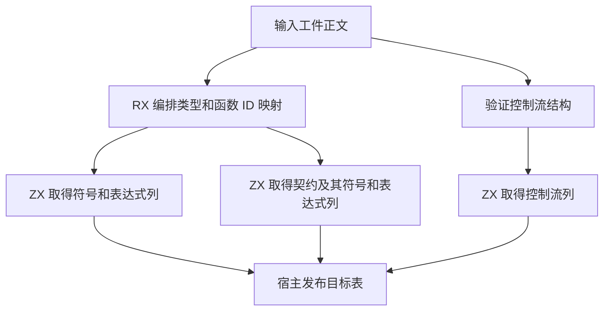

# 工件正文列物化

## Intent

将工件的符号、表达式、控制流和契约列物化迁入 RX/ZX。跨 arena 发布的列按原长度分配，类型和调用 ID 映射及已复制的文本直接接入目标表。

## Data

原宿主通过 `allocator.dupe` 复制每个不变列。`concat` 会为增长预留空间，`map` 会逐项追加。ZX 增加无参 `array.slice()`，返回浅复制后的数组。Source 生成路径复用已有集合分配和批量复制的结构化 AST，初始 seed 生成对应的 Zig。空数组不消耗底层分配。标量、可空值和枚举列共用这一操作。

## Edges

`slice()` 只复制数组容器和元素表示，元素所引用的对象及文本继续共享；所有权检查保留这些引用的借用约束。当前支持无参形式。暂时沿用普通循环表示执行含 `slice()` 的循环。新增枚举值追加在既有值之后。初始常量求值器的生成快照通过 `bootstrap-constant-seed` 同步更新。

## Answer

生成代码核对每个不变列的分配和复制。验证源工件销毁后的链接结果、契约、控制流合法性、缓存恢复和 Zig 分配失败。Source 三代对齐与整仓冷构建同时覆盖初始引导及 Source 执行路径。

生成 Zig 的符号、表达式和控制流复制分别有 3、86 和 27 组 `alloc(len)` 与 `@memcpy`，均没有增长预留。196 项 Zig 回归、47 项安装版检查和六组导入对照通过。临时运行探针覆盖了副本修改后原数组的内容、循环内复制以及空数组。原生缓存验证保持两个原生条目命中，冷编译和热恢复输出一致。

上一阶段 Source 第 3 代引导生成支持 `slice()` 的过渡工具。随后使用已经接入正文列物化的 Source 工具完成连续三代自编译，均为 22 步通过，两组相邻代各有 11,179 份生成产物逐字节一致。首轮 Native seed 冷构建在旧常量快照的枚举布局校验中停止，从 RX/ZX 重新生成快照后完整构建 70 步通过。

冷构建在同一目录用 Zig 0.17.0、ReleaseSmall、12 个并发槽与四个 LLVM 分区执行。工具本体由 Native seed 引导，安装版运行 Source。

| 版本       | 墙钟（秒） | CPU（秒） | 进程树峰值 RSS（MB） | 单进程峰值 RSS（MB） |
| ---------- | ---------: | --------: | -------------------: | -------------------: |
| 固定基线   |     117.82 |    207.44 |             2,328.74 |             2,087.88 |
| `37c775bf` |     113.44 |    204.24 |             2,390.02 |             2,156.66 |
| 正文列物化 |     112.16 |    203.47 |             2,262.60 |             2,118.50 |

较上一阶段，墙钟减少 1.28 秒、CPU 减少 0.77 秒，树峰值和单进程峰值分别下降 127.42 MB 和 38.16 MB。LLVM 分区合计峰值下降 48.68 MB。较固定基线，墙钟减少 5.66 秒，CPU 减少 3.97 秒，树峰值下降 66.14 MB，单进程峰值仍高 30.62 MB。
