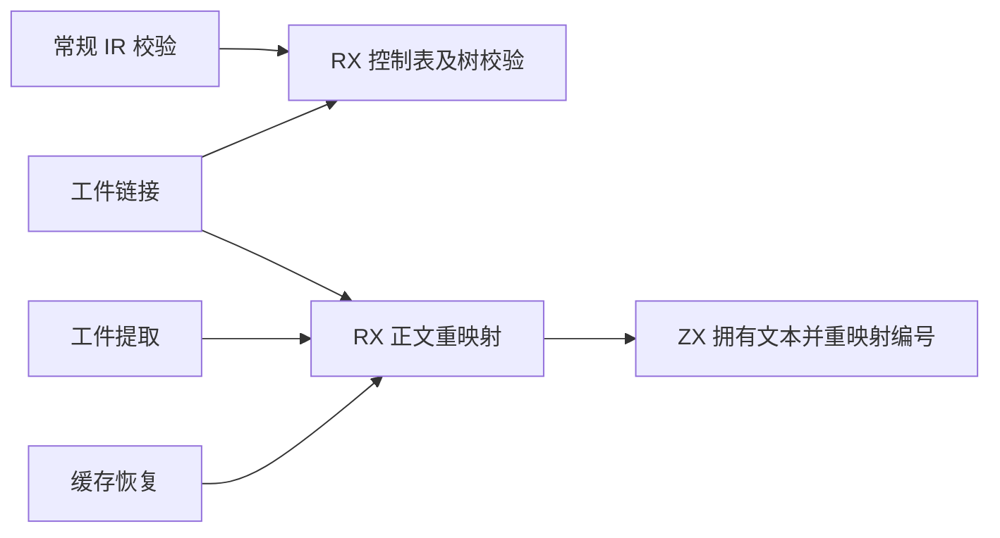
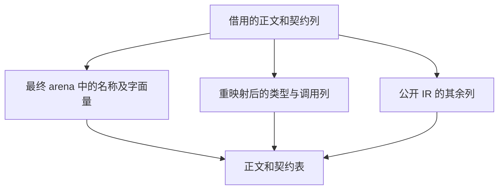

# 工件正文结构与文本所有权

## Intent

统一 IR 校验与工件链接的控制流结构规则。正文及契约中的名称、字面量与编号在 RX/ZX 的重映射阶段写入最终 arena。

## Data

工件链接此前使用 Zig 校验控制表及其树结构。常规 IR 校验已经有对应的 ZX 实现。正文重映射已经能登记新类型编号与调用编号，但名称与字面量仍由宿主遍历复制。

## Edges

保留外部输入的结构校验，已验证的工件按原有路径复用证明。已重映射的编号和已取得所有权的字符串直接进入最终表。Zig 仍负责公开 IR 描述符和不变列的物理复制，初始 seed 保留独立实现。

## Answer

用既有控制流、契约、缓存和生命周期检查验收，核对 Source 三代产物和同口径冷构建。控制表校验先证明子块排在父块前。树校验用一个按块数预留的深度数组，子块挂接后用保留值标记，单块正文无需临时数组。

### 正确性

222 项既有回归和 47 项安装版检查通过，包括无效 IR 和契约拒绝、库重新发布、工件独立生命周期及分配失败。两槽 Store 的进程内及解码后缓存均复用两个模块，生成字节一致。200 模块工程的缓存负载、路径、上下文摘要和生成结果一致。冷生成墙钟中位数由 0.11 秒降为 0.10 秒，两版热恢复均为 0.08 秒。库契约专项首次误用了普通发布夹具，按正式构建传入编译库夹具后全部通过。

上一版 Source 第 3 代引导本轮，三代各通过 22 步。两组相邻代各有 11,163 份生成产物逐字节一致。第一轮冷构建因磁盘空间不足中断，清理可重新生成的缓存后恢复。

### 整仓冷构建

同目录使用 Zig 0.17.0、ReleaseSmall、12 核及四个 LLVM 分区。每轮本地与全局缓存为空，关闭常驻生成。工具由 Native seed 引导，安装版运行 Source。核对了 11,209 个构建输入，完整构建均通过 70 步。

| 版本              | 墙钟（秒） | CPU（秒） | 树峰值 RSS（MB） | 单进程峰值 RSS（MB） | LLVM 分区合计峰值 RSS（MB） |
| ----------------- | ---------: | --------: | ---------------: | -------------------: | --------------------------: |
| 固定基线          |     117.82 |    207.44 |         2,328.74 |             2,087.88 |                           — |
| 上一版 `4bb64383` |     112.48 |    204.73 |         2,319.02 |             2,164.90 |                    2,227.01 |
| 迁移初版          |     114.69 |    204.92 |         2,338.24 |             2,155.66 |                    2,309.59 |
| 迁移初版复测      |     114.97 |    207.77 |         2,242.59 |             2,177.12 |                    2,214.04 |
| 上一版同期对照    |     112.94 |    204.11 |         2,365.70 |             2,151.24 |                    2,209.38 |
| 合并树状态后      |     111.83 |    204.38 |         2,395.77 |             2,153.53 |                    2,243.79 |

最终版比上一版的记录快 0.65 秒、CPU 少 0.35 秒，比同期对照快 1.11 秒、CPU 多 0.27 秒。相对原固定基线，墙钟少 5.99 秒，CPU 少 3.06 秒。最终版的进程树峰值相对历史上一版增加 76.75 MB，相对同期对照增加 30.07 MB。树峰时有四个 LLVM 分区和一个 487.88 MB 的 Zig 进程重叠，采样只得到其进程名。LLVM 分区合计峰值较历史上一版增加 16.78 MB，单进程峰值减少 11.37 MB。相对固定基线，树峰值仍高 67.03 MB，单进程峰值仍高 65.65 MB。
