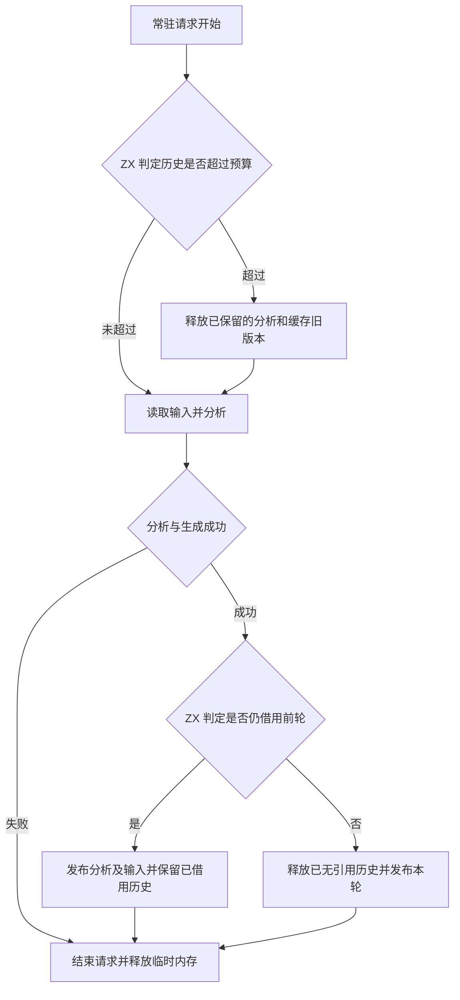
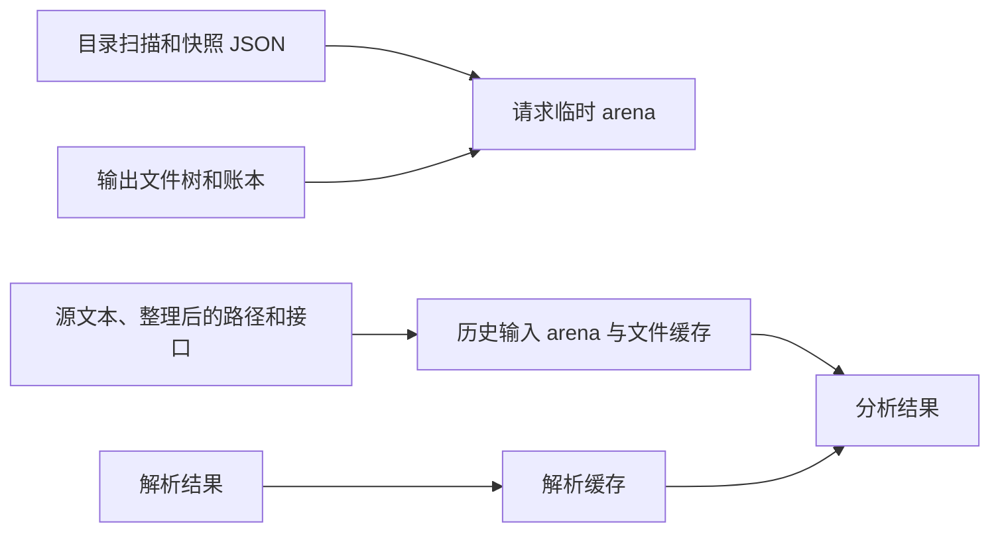

# 常驻生成请求的内存生命周期

## Intent

将常驻生成器的历史保留规则迁入 ZX，缩短目录扫描、输入快照和输出排版临时数据的生命周期。保留历史仍能直接借用未修改文件及解析结果。

## Data

旧实现将成功请求的整个 arena 挂入历史，以保证路径、展开后的 ZX 源码和包描述符有效。该 arena 也包含目录树、快照 JSON、输出账本和构造文件树的中间值。分离后，结果继续借用原始文本，只有分析所需的路径和描述符随历史保留。目录扫描在构造项目路径时直接写入分析输入 arena。项目清单中的包与外部接口字段只在常驻模式下移入分析输入 arena。

## Edges

保留预算沿用 3 GiB 的分析和输入 arena 容量上限，按发布增量计数，超过后在下一常驻请求开始前释放。这个量既不包含解析缓存当前版本，也不等于进程 RSS。重复读到字节相同的文件保留原文本和摘要，仅更新元数据，避免把同一内容的多个副本挂到历史。RX 解析缓存先准备替换记录再提交，分配失败仍可保留旧缓存。解析和文件存储、arena 所有权交接及系统 I/O 仍由 Zig 宿主管理，初始 seed 保留原生判定。

## Answer

274 模块对照覆盖同内容原地重写、正文编辑与恢复、改变签名及依赖、修改 RX 图，以及 ZX 和 RX 语法错误与 ZX 语义错误的恢复。每轮重分析数量与上一版本一致，成功输出逐字节等于独立生成的输出。

使用上一版本与本阶段的 Source 第三代生成器，固定 599 个入口、四个生成分区、Zig 0.17.0 和 ReleaseSmall。连续 12 次修改同一函数体中的注释，每次重分析 2 个模块并复用 4,756 个模块。第 12 次编辑后，常驻进程 RSS 从 1,510.33 MB 降到 1,269.61 MB，相差 240.72 MB。12 次编辑的端到端中位数从 358.0 ms 到 355.0 ms，推导均为 8 ms。初始与最后一轮均核对 10,605 个输出文件，最终结果也与同输入独立生成逐字节一致。

三代 Source 自编译各通过 22 步，两组相邻阶段均核对 11,335 个文件，内容逐字节一致。

解析缓存、RX 文本和依赖图、串行及并行推导共 262 项 Zig 回归通过。安装版持久缓存、应用 watch 和库 watch 共 7 项检查通过。

整仓冷构建使用 Zig 0.17.0、ReleaseSmall、12 核、四个 LLVM 分区及独立空缓存。Native seed 引导安装版，安装版启用 Source 分析和生成。释放以前阶段可重建的测量缓存后，完整冷构建通过 70 步。

| 样本     | 墙钟（秒） | CPU（秒） | 进程树峰值（MB） | 单进程峰值（MB） |
| -------- | ---------: | --------: | ---------------: | ---------------: |
| 固定基线 |     117.82 |    207.44 |          2328.74 |          2087.88 |
| 上一阶段 |     111.55 |    206.03 |          2374.42 |          2125.23 |
| 本阶段   |     111.95 |    205.05 |          2310.67 |          2148.61 |

墙钟较上一阶段增加 0.40 秒，CPU 减少 0.98 秒。较固定基线，墙钟减少 5.87 秒，CPU 减少 2.39 秒。进程树峰值较上一阶段下降 63.75 MB，单进程峰值上升 23.38 MB，仍比固定基线高 60.73 MB。树峰出现在 LLVM 分区并行编译期间，冷构建采样不能用来衡量常驻请求历史的内存收益。
