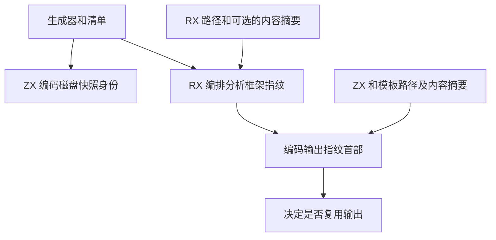

# 构建输入指纹自举

## Intent

将构建输入的摘要编码迁入 RX/ZX，保持已有缓存格式，并核对输入变更后的失效行为。

## Data

分析框架指纹依次写入生成器身份、指纹域、清单、按路径排列的 RX 输入和原生接口。只校验项目结构时省略 RX 内容摘要。输出指纹包含分析框架、生成分区数，以及 ZX 源码和模板的路径与内容摘要。磁盘快照身份另含当前工作目录，RX 解析缓存仍按依赖包的清单顺序编码名称和入口。固定宽度整数使用小端序，与当前发行目标上以前使用的本机编码一致。

## Edges

文件读取、流式 SHA-256、逐文件 Blake3 和磁盘发布由宿主管理。编码使用固定大小的栈批次、已存在的 Writer 和源文本视图，无需拼接完整输入缓冲。初始 seed 保留等价的编码。快照在校验和有效时才解析 JSON，并通过原子替换发布。过长的输出标记按失效处理，可用同一输入重建。

## Answer

独立复算跨批次的快照身份和输出摘要，与原格式逐字节一致。模板编辑和恢复、原生接口变更、分区变化、快照校验和损坏及超长输出标记全部通过。相邻的三代 Source 自编译各通过 22 步，并核对 11,357 个生成文件逐字节一致。

解析缓存、RX 依赖图和 RX 文本共通过 19 项 Zig 回归。安装版的持久缓存和应用 watch 恢复通过 6 项检查。

同一 601 入口项目以两个 Source 第三代生成器交替执行 12 次正文注释编辑，推导中位数均为 8 ms，端到端中位数由 355.7 ms 降到 354.5 ms。舍去首轮热身后，六次无修改构建中位数由 19.9 ms 到 20.0 ms。两版最终输出和独立生成逐字节一致，共 10,614 个文件。

整仓冷构建使用 Zig 0.17.0、ReleaseSmall、12 核、四个 LLVM 分区和独立空缓存。Native seed 引导安装版，安装版启用 Source 分析和生成。

| 样本                           | 墙钟（秒） | CPU（秒） | 进程树峰值（MB） | 单进程峰值（MB） |
| ------------------------------ | ---------: | --------: | ---------------: | ---------------: |
| 固定基线                       |     117.82 |    207.44 |          2328.74 |          2087.88 |
| 上一阶段                       |     111.95 |    205.05 |          2310.67 |          2148.61 |
| 上一阶段同期对照               |     111.28 |    205.05 |          2351.86 |          2158.77 |
| 与 Source 自编译重叠的候选样本 |     126.02 |    228.86 |          2354.79 |          2147.24 |
| 隔离后最终版本                 |     111.95 |    204.90 |          2418.56 |          2123.76 |

两份候选的四个 LLVM 分区对象逐字节一致。同期对照与上一阶段历史样本的分区对象也逐字节一致。最终版本完整构建 70 步通过，较同期对照墙钟增加 0.67 秒、CPU 减少 0.15 秒。较固定基线墙钟减少 5.87 秒、CPU 减少 2.54 秒。

最终版本的进程树峰值较同期对照高 66.70 MB，出现在 LLVM 分区编译与测试进程重叠时。只累计各采样点的 LLVM 分区进程，候选峰值为 2,342.58 MB，较同期对照高 68.47 MB，另一候选样本也高 52.13 MB。候选最大分区进程约 970 MB，上一阶段历史样本约 896 MB。单进程总峰值较同期对照下降 35.01 MB，较固定基线仍高 35.88 MB。下一轮需要继续追踪分区布局与并行峰值。
