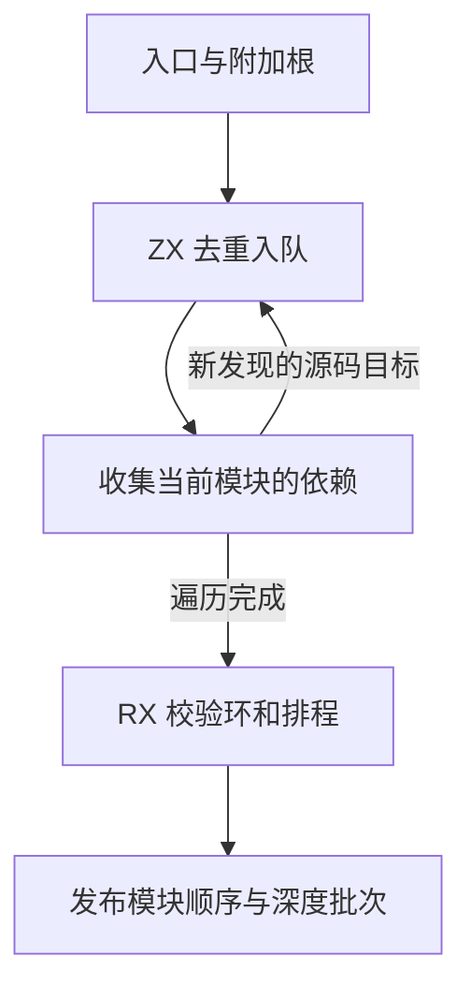
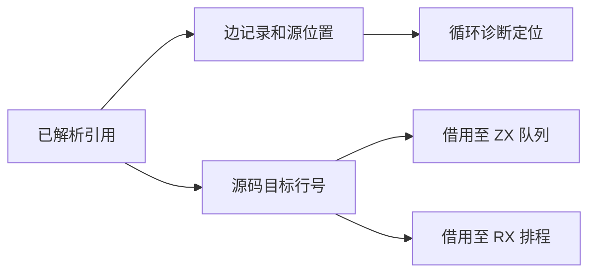

# 混合源码图依赖收集与排程

## Intent

把混合源码图中依赖去重和入队迁到 ZX，让 RX 排程直接消费收集时已经确定的依赖顺序，保留源码模组、RX 模组和 Store 定义的行为及诊断。

## Data

旧流程先在 Zig 中去重入队，再扫描全部边记录两次，为排程重建连续目标数组。现在 Zig 在登记源码边时同步写入目标行号。ZX 借用本轮新增的目标范围完成去重入队。排程使用相同的目标列，仅记录每个源码行在其中的起止位置。第一次发现的依赖次序、重复引用记录和根模块顺序保持原样。

## Edges

收集仍按广度优先决定何时读取解析结果和报告缺失引用，循环检查仍由排程深度优先遍历。源码位置、原生和编译库引用保留在原边记录中。Zig 负责解析器调用、引用解析、队列存储和读取。新增目标列只在构建本次源码图时存在。

## Answer

临时探针覆盖发现顺序不同于注册顺序、重复及附加根、重复引用、不可达模块包含无效源码时的原有行为。39 组 236 项 Zig 回归和 47 项安装版检查通过，其中包括 512 个三节点有向图的穷举。优化后三代 Source 自编译各通过 22 步，两组相邻代各有 11,242 份生成产物逐字节一致。

整仓冷构建使用 Zig 0.17.0、ReleaseSmall、12 核、四个 LLVM 分区和独立空缓存。Native seed 引导安装版，安装版运行 Source 分析和生成。首轮 70 步通过，墙钟 115.57 秒、CPU 205.01 秒，进程树峰值 2,359.15 MB、单进程峰值 2,144.49 MB。较上一阶段确认轮，墙钟多 3.38 秒，CPU 多 0.01 秒。四个 LLVM 分区晚约 3.22 秒启动，其中两个分区对象逐字节一致。

274 模块混合工程在同一目录交替执行五轮冷生成。前后墙钟、CPU 中位数分别保持 0.08 秒和 0.16 秒。单进程峰值中位数由 31.26 MB 降至 31.10 MB，生成内容逐字节一致。

同期上一版重建的四个 LLVM 分区对象与其历史样本逐字节一致。候选第二轮的四个分区对象也与首轮候选逐字节一致。同期对照和候选第二轮分别在 52.71 秒及 54.45 秒启动主生成器，在 55.60 秒及 57.25 秒启动 LLVM 分区。主生成器分别用 746 ms、706 ms 做推导，两轮生成阶段均约 741 ms。LLVM 分区同时采样的合计峰值从 2,321.99 MB 降到 2,284.83 MB。

| 样本       | 墙钟（秒） | CPU（秒） | 进程树峰值（MB） | 单进程峰值（MB） |
| ---------- | ---------: | --------: | ---------------: | ---------------: |
| 固定基线   |     117.82 |    207.44 |          2328.74 |          2087.88 |
| 同期上一版 |     112.36 |    204.18 |          2350.56 |          2145.91 |
| 候选首轮   |     115.57 |    205.01 |          2359.15 |          2144.49 |
| 候选第二轮 |     114.20 |    205.28 |          2390.75 |          2123.86 |
| 候选第三轮 |     114.07 |    207.23 |          2414.07 |          2124.05 |

初版三轮候选的四个 LLVM 分区对象逐字节一致。墙钟中位数比同期上一版多 1.84 秒，CPU 多 1.10 秒。第三轮树峰时，480.43 MB 的 Zig 测试编译与四个 LLVM 分区重叠。

ZX 排程优化后，已按深度排列的序列直接返回原存储，只有需要稳定重排的序列才建计数表。计数表大小取决于实际最大深度。临时探针对照了重排后的稳定顺序及批次边界。

同一 274 模块夹具隔离复测优化版。墙钟和 CPU 中位数分别保持 0.09 秒和 0.16 秒，生成内容逐字节一致，单进程峰值中位数从 31.10 MB 到 31.16 MB。

优化版冷构建墙钟 111.67 秒、CPU 204.49 秒，较同期上一版分别减少 0.69 秒和增加 0.31 秒。相比固定基线，墙钟减少 6.15 秒、CPU 减少 2.95 秒。进程树峰值 2,384.35 MB，较同期对照多 33.79 MB，峰值时有 488.88 MB 的 Zig 测试编译与 LLVM 分区重叠。仅统计四个 LLVM 分区时，其同时采样的合计峰值由 2,321.99 MB 降至 2,293.76 MB。单进程峰值为 2,136.47 MB，较同期对照减少 9.44 MB。
