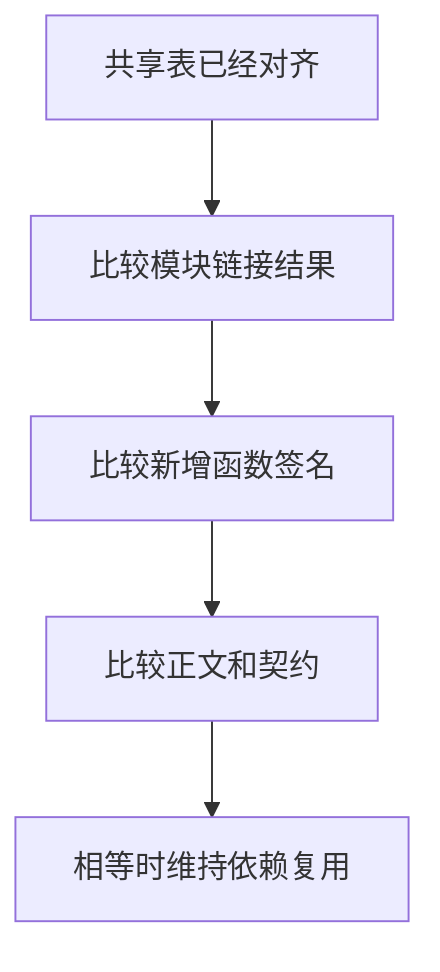
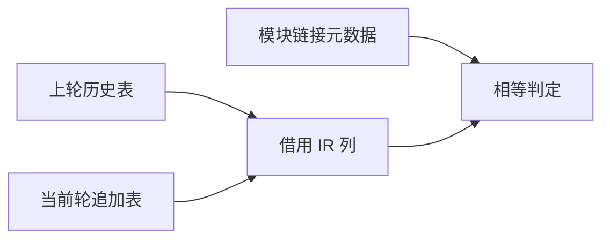

# 混合项目函数历史比较

## Intent

将混合项目复用的函数签名、正文、契约和链接元数据相等规则迁入 RX/ZX，保持失效范围和当前产物。

## Data

函数表已有列存储。沿用 IR 列比较，从检查点借用签名列，并借用追加函数的正文和契约列。链接元数据按导出、常量、成员和初始化器各自的值语义比较。

## Edges

比较包含源位置、原始类型编号、原生签名字段、嵌套契约以及浮点位表示。Zig 宿主负责借用存储、遍历仍是宿主指针的契约表和逐行适配链接记录。初始 seed 沿用旧比较入口。

## Answer

274 模块常驻生成器对照覆盖正文和注释编辑、RX 编辑、改变导入目标、对象字段名变更及恢复。两版的重分析数量一致，产物与独立冷生成逐字节一致。注释编辑和恢复均重分析三个模块，复用 276 个生成文件。

普通和并行 RX 推导、库初始化器及原生链接共 275 项回归通过。安装版持久缓存五项检查、watch 恢复一项检查通过。三代 Source 自编译各通过 22 步，两组相邻阶段的 11,304 个生成文件逐字节一致。

整仓使用 Zig 0.17.0、ReleaseSmall、12 核、四个 LLVM 分区及独立空缓存。Native seed 引导安装版，安装版启用 Source 分析和生成。完整冷构建通过 70 步。

| 样本             | 墙钟（秒） | CPU（秒） | 进程树峰值（MB） | 单进程峰值（MB） |
| ---------------- | ---------: | --------: | ---------------: | ---------------: |
| 固定基线         |     117.82 |    207.44 |          2328.74 |          2087.88 |
| 上一阶段         |     111.90 |    204.40 |          2308.93 |          2141.88 |
| 上一阶段同期复测 |     112.34 |    204.76 |          2356.41 |          2134.61 |
| 本阶段           |     112.16 |    205.25 |          2385.69 |          2141.29 |
| 本阶段复测       |     112.96 |    206.02 |          2385.15 |          2143.83 |

首轮较上一阶段墙钟增加 0.26 秒、CPU 增加 0.85 秒，较固定基线分别减少 5.66 秒和 2.19 秒。前端类型分析从 735 ms 到 744 ms，生成从 754 ms 降至 743 ms。两轮候选四个 LLVM 分区目标文件逐字节一致，树峰均出现在分区并行编译期间。

上一提交用相同配置复测，LLVM 分区目标文件与其历史样本逐字节一致，树峰仍相差 47.48 MB。两轮候选较同期对照的墙钟分别变化 −0.18 和 +0.62 秒，CPU 分别增加 0.49 和 1.26 秒，树峰分别增加 29.28 和 28.74 MB。相对固定基线，首轮候选树峰高 56.95 MB，单进程峰值高 53.41 MB。后续继续跟踪分区并行峰值。
