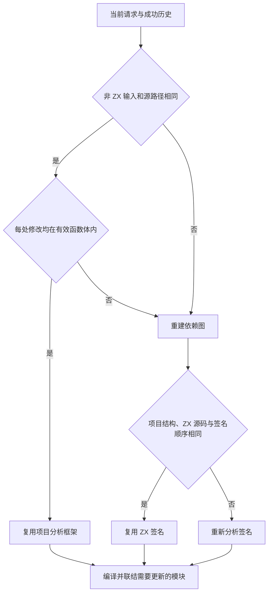
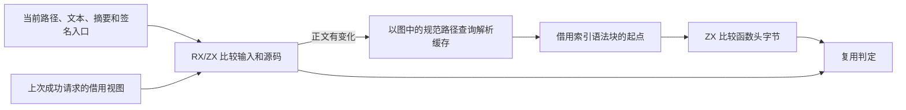

# 混合项目历史准入

## Intent

将常驻编译器的历史准入判定迁入 RX/ZX，使仅修改 ZX 函数正文的请求复用依赖图、签名和 RX 类型约束。普通 RX 编辑在可达 ZX 签名顺序及源码均相同时复用签名。

## Data

Source 解析器已经提供默认函数体的语法块，原先的准入只读取了旧解析器的 AST。Source 分支现直接读取块起点。对有修改的文件，准入用当前有效解析的起点比较截至左花括号的原始字节，只借用两段切片。解析失败、文件清单变化、接口变化和导入变化保留完整分析路径。

## Edges

仅正文变更时，未改模块从上次成功分析取摘要，避免失败请求替换解析缓存后污染复用判定。已修改的模块使用以图中相同路径缓存的当前解析。顺序签名入口复用已有切片，无需重建路径表。生成 Zig 使用原有的字节比较和借用切片，纯比较以空分配器执行。宿主还管理解析缓存、混合记录和 arena 生命周期，初始 seed 保留原生判定。

## Answer

274 模块常驻对照覆盖正文、注释、正文局部类型、签名类型、RX 表达式、RX 可达入口、ZX 导入，以及语法和语义失败后的恢复。每轮成功产物与独立干净生成逐字节一致，失败的诊断位置及内容一致。普通正文编辑重分析 3 个模块，推导耗时由日志记录的 2 ms 降到 1 ms 以下。失败后恢复原文只重分析入口，复用 273 个模块。

三代 Source 自编译各通过 22 步，两组相邻阶段的 11,326 个生成文件逐字节一致。

解析缓存、RX 依赖图及串行和并行推导共 259 项 Zig 回归通过。安装版的持久缓存、应用 watch 恢复和库 watch 恢复共 7 项检查通过。

完整冷构建使用 Zig 0.17.0、ReleaseSmall、12 核、四个 LLVM 分区和独立空缓存。Native seed 引导安装版，安装版启用 Source 分析和生成。完整构建通过 70 步。

| 样本     | 墙钟（秒） | CPU（秒） | 进程树峰值（MB） | 单进程峰值（MB） |
| -------- | ---------: | --------: | ---------------: | ---------------: |
| 固定基线 |     117.82 |    207.44 |          2328.74 |          2087.88 |
| 上一阶段 |     112.16 |    205.25 |          2385.69 |          2141.29 |
| 本阶段   |     111.55 |    206.03 |          2374.42 |          2125.23 |

较上一阶段，墙钟减少 0.61 秒，CPU 增加 0.78 秒，进程树峰值下降 11.27 MB，单进程峰值下降 16.06 MB。较固定基线，墙钟减少 6.27 秒，CPU 减少 1.41 秒，进程树峰值仍高 45.68 MB。最终样本与补充失败恢复前的样本生成了字节一致的 LLVM 分区目标文件，两次树峰相差 15.30 MB，均在 LLVM 分区并行编译时采到。当前采样不足以把峰值差归因于历史准入。
