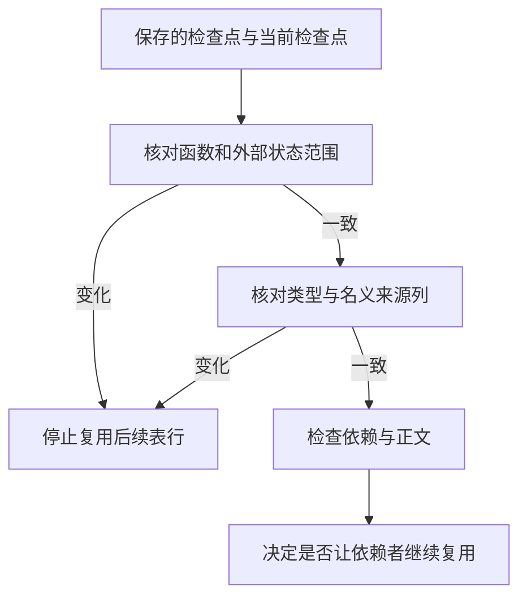

# 混合项目历史表对齐

## Intent

将混合项目增量复用的共享表对齐迁入 RX/ZX。模块正文变化后，保留原有类型编号、名义类型来源和依赖失效规则。

## Data

初次复用和重新分析后都比较函数数量、外部状态数量与共享表新增的列。类型与名义来源表都是列存储，整数列借用为字节切片，字符串列借用原切片。列比较从库初始化器移到共享 IR 模块，库初始化器和混合项目共用。生成的对齐入口无需分配。

## Edges

保留初始检查点、每模块追加范围、编译依赖标记和正文比较语义。宿主持有列存储与检查点，并继续处理完整函数体及链接元数据的比较。初始 seed 保留原来的比较实现。

## Answer

对照 274 模块常驻生成器的正文编辑、恢复和导入变更。正文新增对象类型、只更改对象字段名及还原，都重分析 273 个模块并复用一个，与旧版一致。保持类型形状的普通 ZX 正文编辑仍重分析三个，RX 正文编辑仍重分析两个。改动及恢复后的产物在两版间逐字节一致，也与独立冷生成一致。

普通和并行 RX 推导、库初始化器共 269 项回归通过。安装版持久缓存 5 项回归通过。三代 Source 自编译各通过 22 步，两组相邻阶段的 11,276 个生成文件逐字节一致。

整仓使用 Zig 0.17.0、ReleaseSmall、12 核、四个 LLVM 分区及独立空缓存。Native seed 引导安装版，安装版启用 Source 分析和生成。冷构建通过 70 步。

| 样本     | 墙钟（秒） | CPU（秒） | 进程树峰值（MB） | 单进程峰值（MB） |
| -------- | ---------: | --------: | ---------------: | ---------------: |
| 固定基线 |     117.82 |    207.44 |          2328.74 |          2087.88 |
| 上一阶段 |     113.12 |    206.02 |          2357.87 |          2127.56 |
| 本阶段   |     111.90 |    204.40 |          2308.93 |          2141.88 |

墙钟比上一阶段减少 1.22 秒，CPU 减少 1.62 秒。进程树峰值减少 48.94 MB，单进程峰值增加 14.32 MB。与固定基线相比，墙钟减少 5.92 秒，CPU 减少 3.04 秒，进程树峰值减少 19.81 MB，单进程峰值增加 54.00 MB。
