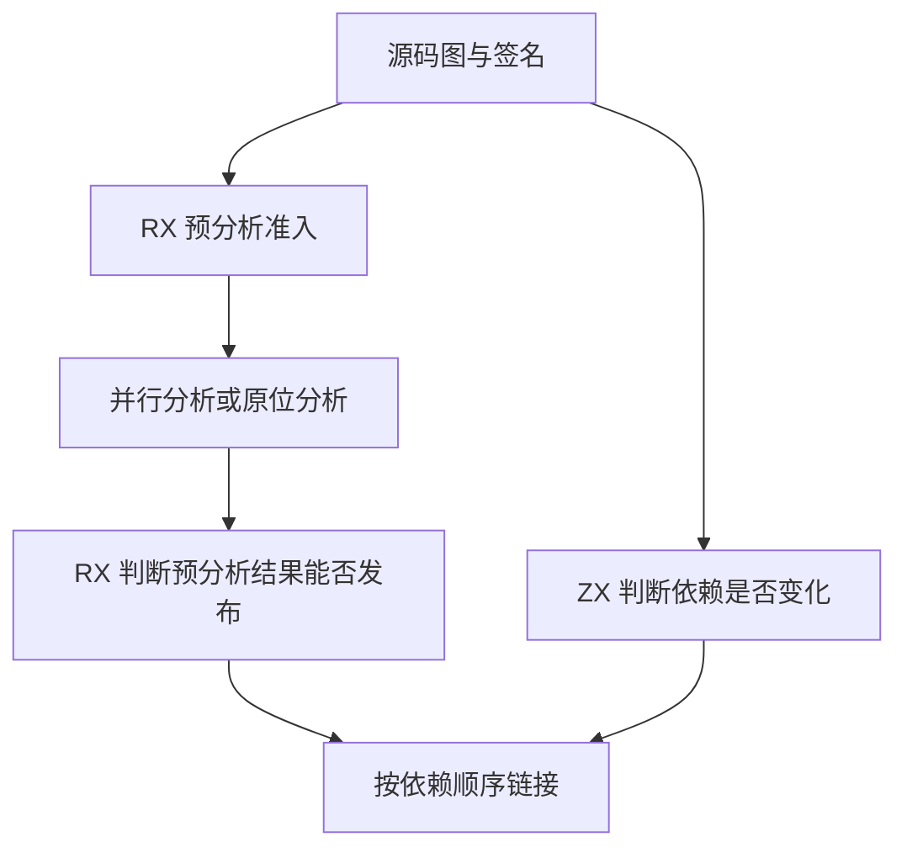
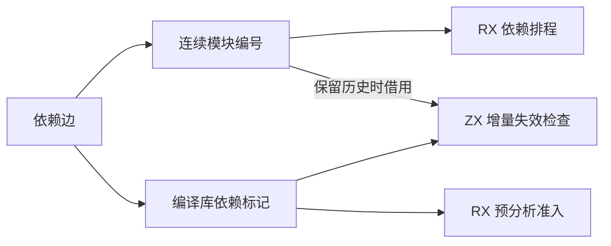

# 混合项目正文准入与增量失效

## Intent

由 RX 决定混合模块是否参加预分析，以及预分析结果是否可以发布。ZX 根据源码图的依赖编号判断增量失效。保留原来的绑定、诊断和链接顺序。

## Data

源码图已有按模块记录的源依赖编号。记录编译库边时可以同时标记其所属模块，预分析与增量恢复因此可以共享同一事实。只有保留增量历史的分析需要继续持有源依赖编号。没有历史的分析无需建立恢复检查点或读取模块摘要。

增量历史直接引用已发布的模块结果列和源码图路径。这两份数据由同一轮分析的 arena 持有。复用签名帧时，模块身份可以用原图指针确认。发生源码图重建时继续检查路径和顺序。

## Edges

工作线程、共享表写入和原位诊断仍由宿主执行。预分析失败时仍在原链接位置重试。依赖编号不改变边记录、错误位置或模块排序。编译库依赖仍使增量分析保守失效。

## Answer

连续三代 Source 自编译均通过 22 步。两组相邻代各有 11,257 份生成文件逐字节一致。

274 模块的常驻生成器对照使用前一阶段和本阶段各自经 Source 生成的第三代工具。编辑及还原 ZX 叶子正文，各重分析三个模块并复用 271 个。编辑及还原 RX 子模块，各重分析两个并复用 272 个。改写导入目标使可达集合新增一个模块，两版均重新分析全部 275 个模块，还原后均重新分析 274 个。每次输出在两版间逐字节一致，也与同一输入的独立冷生成一致。检查生成 Zig，依赖失效循环直接借用编号和布尔标记列，函数体没有分配或复制列数据。

初版通过 341 项其余 Zig 回归，以及完整 RX 推导套件中的 135 项。最终版复测 RX 依赖图、普通推导及并行推导，共通过 242 项。普通推导套件有三个既有的分配失败用例报告 `SwallowedOutOfMemoryError`，用独立构建的 `f5ae7a30` 对照得到相同的失败。最终安装版通过 47 项集成和 RX watch 的编辑、删除及恢复检查。

整仓采用 Zig 0.17.0、ReleaseSmall、12 核、四个 LLVM 分区及各轮独立空缓存。Native seed 引导安装版，安装版执行 Source 分析和生成。完整冷构建通过 70 步。

| 样本             | 墙钟（秒） | CPU（秒） | 进程树峰值（MB） | 单进程峰值（MB） |
| ---------------- | ---------: | --------: | ---------------: | ---------------: |
| 固定基线         |     117.82 |    207.44 |          2328.74 |          2087.88 |
| 上一阶段历史样本 |     111.67 |    204.49 |          2384.35 |          2136.47 |
| 候选初版         |     133.64 |    235.46 |          2363.18 |          2130.69 |
| 旧版同期重建     |     125.66 |    231.93 |          2369.00 |          2140.90 |
| 候选最终隔离轮   |     112.58 |    205.73 |          2375.61 |          2133.48 |

候选初版较上一阶段历史样本慢 21.97 秒。到主生成器启动时，两轮已相差约 10.66 秒。旧版同期重建与历史样本的四个 LLVM 对象逐字节一致，但墙钟仍增加 13.99 秒。同期旧版重建期间有 Source 自编译重叠，该样本仅用于辨别环境波动。候选最终隔离轮的四个 LLVM 对象与初版相同。

最终轮较上一阶段历史样本墙钟增加 0.91 秒，CPU 增加 1.24 秒（0.61%），符合墙钟在 1 秒容差内时可接受小幅 CPU 增长的规则。相对固定基线，墙钟少 5.24 秒，CPU 少 1.71 秒。进程树及单进程峰值较上一阶段分别少 8.74 MB 和 2.99 MB，仍比固定基线分别高 46.87 MB 和 45.60 MB。四个 LLVM 分区同时采样合计峰值从 2,293.76 MB 增到 2,305.08 MB。
