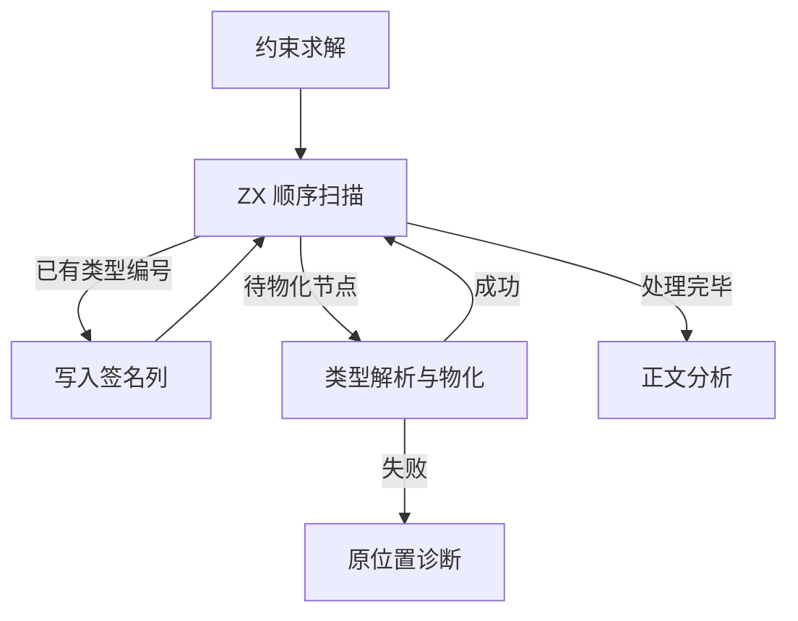
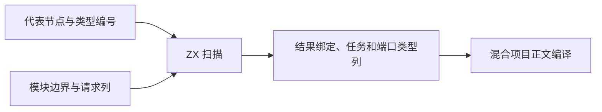

# 混合项目签名批量发布

## Intent

把约束图扫描及向签名列写入类型编号迁入 ZX，保持诊断位置、首次错误和复合类型登记次序。

## Data

约束已按模块收集结果绑定和并行任务。签名发布按绑定、任务、输入、输出的顺序消费，常见请求的代表节点已带有最终类型编号。ZX 在借用的列上连续处理已确定的类型，遇到需要物化的节点才暂停。物化仍沿用通用类型解析器。

绑定名称与节点编号分列。发布时以最终类型编号覆盖已消费的节点编号，正文直接读取同一列。输入输出也覆盖原请求列。并行 Task 保留原来的登记顺序，并按 Task ID 写入模块的结果范围。嵌套 Task 的登记顺序与编号顺序可能不同。

## Edges

Zig 继续持有约束图和类型表，在 ZX 扫描暂停时调用现有分配与物化入口，并持有最终签名的切片描述符。已发布的绑定列由分析结果持有。发布出错时按原顺序停止。初始 seed 和 32 位宿主沿用按相同顺序逐项解析的路径。

## Answer

嵌套 Parallel Task 探针分别发布内层对象、外层对象和模块输出。旧版与新版生成文件逐字节一致，已确定类型的批量发布入口在零容量分配器下执行。生成 Zig 接收借用的列描述符，循环内没有列分配或复制。

连续三代 Source 自编译各通过 22 步，两组相邻代各有 11,257 份生成文件逐字节一致。274 模块的常驻生成器对照中，修改或还原 ZX 叶子正文时均重分析三个模块，修改或还原 RX 子模块时均重分析两个。变更导入目标及还原时，两版重新分析的模块数一致。每一步的生成文件与对照及独立冷生成逐字节一致。

476 项 Zig 回归、47 项安装版集成和 RX watch 检查通过。普通 RX 推导套件的三个分配失败用例仍报告与上一阶段相同的 `SwallowedOutOfMemoryError`。

整仓使用 Zig 0.17.0、ReleaseSmall、12 核、四个 LLVM 分区及独立空缓存。Native seed 引导安装版，安装版执行 Source 分析和生成。完整冷构建通过 70 步。

| 样本     | 墙钟（秒） | CPU（秒） | 进程树峰值（MB） | 单进程峰值（MB） |
| -------- | ---------: | --------: | ---------------: | ---------------: |
| 固定基线 |     117.82 |    207.44 |          2328.74 |          2087.88 |
| 上一阶段 |     112.58 |    205.73 |          2375.61 |          2133.48 |
| 本阶段   |     113.35 |    203.40 |          2385.46 |          2142.65 |

较上一阶段，墙钟增加 0.77 秒，CPU 减少 2.33 秒。相对固定基线，墙钟减少 4.47 秒，CPU 减少 4.04 秒。进程树和单进程峰值较上一阶段分别增加 9.85 MB 和 9.17 MB，较固定基线分别增加 56.72 MB 和 54.77 MB。两轮树峰均有 Zig 测试编译和 LLVM 分区重叠。四个 LLVM 分区同时采样合计峰值从 2,305.08 MB 降至 2,250.42 MB。主生成器分析从 714 ms 到 706 ms，生成从 735 ms 到 741 ms，写出从 383 ms 到 418 ms。
