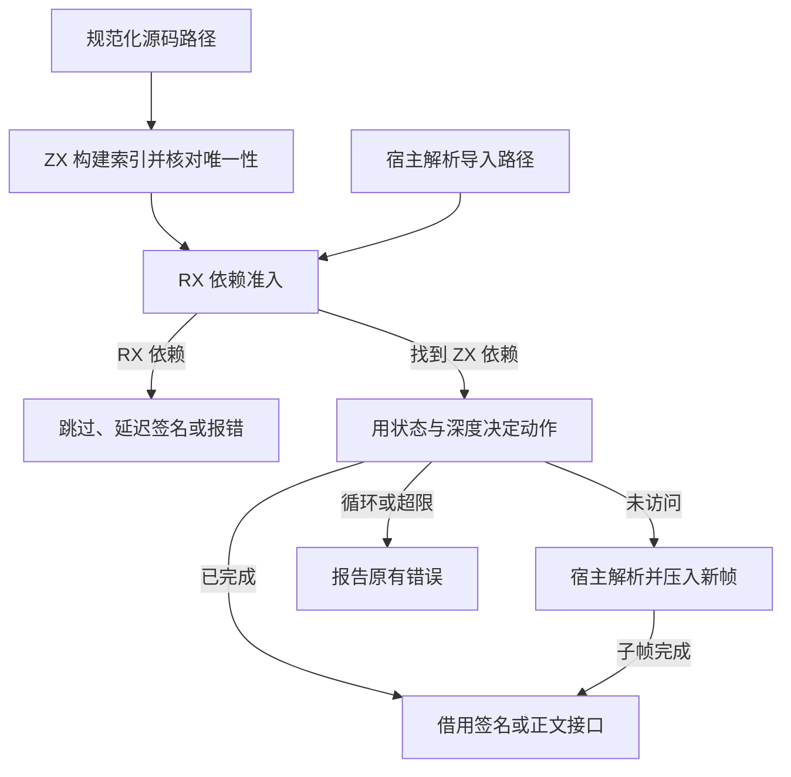

# 源码模块索引与依赖准入

## Intent

将规范路径索引的唯一性校验和源码依赖的准入接成一条 RX/ZX 链。签名与正文共用路径索引，保留它们对 RX 依赖的不同处理，以及原有深度优先遍历和诊断顺序。

## Data

此前 Zig 每归档一条项目路径便单独调用生成的哈希探查入口，依赖准入前又在 Zig 中检查后缀和查询状态。现在主索引按输入顺序在 ZX 中批量填充，发现重复便停止。RX 首次处理一个解析完成的源码路径时，先判断 RX 后缀，再通过原有字节索引探查，并用找到的行号从状态列读取准入条件。准入返回动作以及后续绑定或入栈所需的行号。父帧恢复时沿用已记录的子模块索引。

## Edges

Zig 持有装载状态列与依赖帧的存储，负责路径规范化、目录回退、解析器接线、状态写入和最终绑定。帧状态从模块记录移到按行编号的列，供生成代码直接借用。路径字节沿用项目已有存储。空索引、规范路径重复、缺失依赖、环、深度超限和原生 seed 保留既有语义。

## Answer

临时探针覆盖签名与正文入口的空索引、规范路径重复。目录入口、ZX 和 RX 的导入环、公开接口重导出以及递归恢复的对照结果一致。255 与 256 层依赖链的产物逐字节相同，257 层保留原有诊断和位置。35 组 220 项 Zig 回归及 47 项安装版检查通过。三代 Source 自编译均通过 22 步，两组相邻代各有 11,233 份生成产物逐字节一致。

1,027 模块的冷生成墙钟和 CPU 中位数保持 0.55 秒和 0.58 秒，恢复中位数保持 0.41 秒和 0.44 秒。全量热命中，持久缓存负载一致。编辑及还原叶子各重分析一个模块并复用 1,026 个，输出和独立冷生成一致。

首轮整仓冷构建沿用 Zig 0.17.0、ReleaseSmall、12 核、四个 LLVM 分区和独立空缓存。Native seed 引导安装版，安装版执行 Source 分析与生成。70 步全部通过。较上一阶段历史样本，墙钟增加 2.38 秒，CPU 减少 0.65 秒，进程树和单进程峰值分别下降 58.10 MB 和 20.84 MB。四个 LLVM 分区整体推迟 2.23 秒启动，四个分区自身的采样 CPU 均未上升。分区 0、2 的目标对象与上一阶段逐字节一致。

在同一目录重新构建上一提交，四个 LLVM 分区对象与历史样本逐字节一致。两轮候选的四个分区对象也各自逐字节一致，代价波动主要出现在 LLVM 分区启动前。同期对照与两轮候选的数据如下。

| 样本             | 墙钟（秒） | CPU（秒） | 进程树峰值（MB） | 单进程峰值（MB） |
| ---------------- | ---------: | --------: | ---------------: | ---------------: |
| 固定基线         |     117.82 |    207.44 |          2328.74 |          2087.88 |
| 上一阶段历史样本 |     111.13 |    203.57 |          2343.93 |          2153.71 |
| 上一阶段同期对照 |     113.59 |    208.20 |          2349.33 |          2131.56 |
| 候选首轮         |     113.51 |    202.92 |          2285.83 |          2132.87 |
| 候选确认轮       |     114.93 |    205.13 |          2353.23 |          2147.55 |

两轮候选按中位数比较，墙钟 114.22 秒，较同期对照增加 0.63 秒。确认轮单独多 1.34 秒，LLVM 分区启动也晚约 1.96 秒，同一候选两轮墙钟相差 1.42 秒。同一上一版的历史记录与同期重测相差 2.46 秒。候选 CPU 中位数 204.03 秒，较上一阶段历史记录多 0.46 秒，较同期对照少 4.17 秒。相对固定基线，候选墙钟与 CPU 中位数分别减少 3.60 秒、3.41 秒。

候选进程树峰值中位数为 2,319.53 MB，较固定基线下降 9.21 MB。单进程峰值中位数为 2,140.21 MB，仍比固定基线高 52.33 MB。同期对照和第二轮候选的树峰分别为 2,349.33 MB、2,353.23 MB，其中 LLVM 分区同时采样的合计峰值从 2,320.81 MB 降到 2,309.72 MB。
