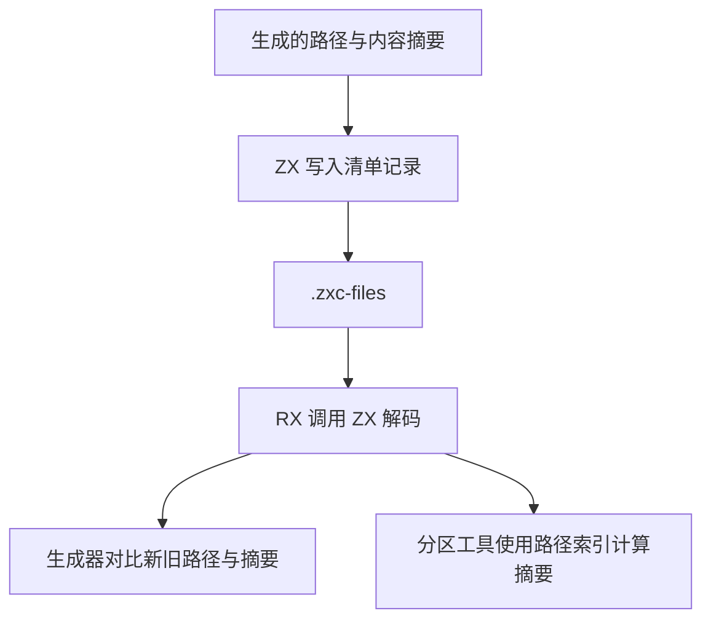

# 生成文件清单自举

## Intent

把 `.zxc-files` 的读写规则迁入 RX/ZX，统一生成器和分区编译工具的解析。保留生成文件顺序、缓存清单字节和原有错误行为。

## Data

旧的生成器读取清单时形成顺序列，分区工具另行扫描文本并形成按路径索引的哈希表。两者用同一种记录格式，生成器负责写出。迁移后，生成器和分区工具调用同一个 RX 入口。ZX 逐行读取并填入宿主预分配的路径和摘要列，路径是原文本的切片。分区消费方使用顺序列更新索引，重复路径保留最后一个摘要。

## Edges

十六进制转换和 Writer 使用标准库。生成器首轮引导使用原生 seed，同时产出独立 host 模块供 Source 生成器和分区工具采用。对齐缺少末尾换行、短行、重复路径、混合大小写十六进制与不可解析摘要的既有行为。

## Answer

Native seed 和两代 Source 重编分别通过 33、22、22 步。两代 Source 的 11,392 个生成文件逐字节一致。Native seed 的输出和 Source 生成物存在预期差别。与上一个 Source 阶段相比，主树仅有共享类型声明及其清单摘要变化，四个 LLVM 分区对象逐字节一致。

旧版和新版分区工具消费同一清单，对照覆盖短行、重复路径、混合大小写十六进制、坏摘要、末行无换行、定向重编和恢复。旧工具生成的清单可直接交给新生成器。修改依赖时，未改文件的字节和时间戳保留，增量产物与干净生成一致，恢复依赖后得到原始字节。解析缓存、RX 依赖图、持久缓存和 watch 的 22 项回归均通过。watch 首次遇到工具链解包写入失败，释放磁盘空间后使用 Zig 0.17.0 外部工具链验证通过。

对 16 分区全部命中的真实生成树交替运行两版分区工具，去掉预热后各 10 次墙钟中位数从 7.77 ms 降至 7.08 ms，峰值 RSS 中位数从 4.28 MB 降至 4.13 MB。对相同生成树执行清单读写，两代 Source 工具各自使用独立函数缓存并预热。三次中位数的墙钟均为 1.70 秒，CPU 均为 6.02 秒，写出阶段均为 13 ms，峰值 RSS 从 857.26 MB 到 858.31 MB。

整仓冷构建使用 Zig 0.17.0、ReleaseSmall、12 核、四个 LLVM 分区及独立空缓存。Native seed 生成安装版，安装版使用 Source 分析和生成。70 步全部通过。

| 样本     | 墙钟（秒） | CPU（秒） | 进程树峰值（MB） | 单进程峰值（MB） |
| -------- | ---------: | --------: | ---------------: | ---------------: |
| 固定基线 |     117.82 |    207.44 |          2328.74 |          2087.88 |
| 上一阶段 |     112.67 |    205.75 |          2278.67 |          2147.78 |
| 本阶段   |     112.05 |    204.78 |          2372.52 |          2136.64 |

较上一阶段，墙钟减少 0.62 秒，CPU 减少 0.97 秒，单进程峰值下降 11.14 MB。进程树峰值增加 93.85 MB，采样增量与四个 LLVM 子进程的合计峰值变化相符。这些子进程生成的对象相同，受改动的分区工具自身峰值从 4.72 MB 到 4.55 MB。较固定基线，墙钟减少 5.77 秒，CPU 减少 2.66 秒，进程树峰值增加 43.78 MB，单进程峰值增加 48.76 MB。
