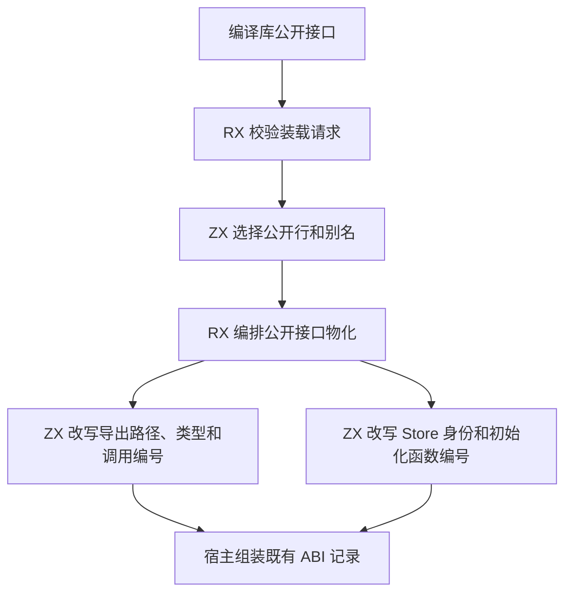
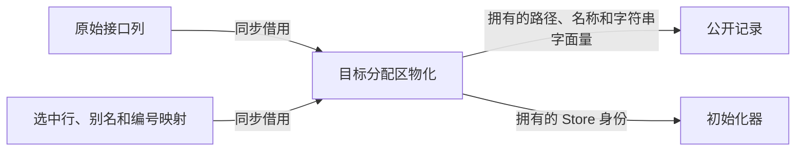

# 编译库公开接口发布

## Intent

在编译库装载阶段，由 RX 编排公开导出与 Store 初始化器的物化，由 ZX 在调用方分配区内改写编号、路径和拥有的文本。公开别名继续按调用方请求的顺序发布并共享内容。

## Data

库图先借用原始公开接口进行校验。选择计划只保留原始行、别名到目标行的映射和每个目标的首次出现位置。此前路径和 Store 标识会在临时区重写，再由 Zig 为持久记录复制。将选择和校验保留在临时区，将文本所有权与重映射放在物化阶段，可以使这些文本只构造一次。

## Edges

RX 签名检查保留仅发布类型、原生模块和调用工作区的约定。空选择、全部选择与单个模块多别名保持既有行为。宿主暂时保留 Zig 对外结构的列到行转换，类型与原生模块表先按既有路径提交。

## Answer

使用上一阶段的 Source 工具生成第一代，再以每代 Source 工具生成下一代。候选冷构建重新构建 Native seed，由它生成安装版的 Source 分析与生成实现。各轮使用独立的 Zig 本地和全局缓存，工具链为 Zig 0.17.0，配置为 ReleaseSmall、12 核。

| 样本     | 墙钟（秒） | CPU（秒） | 树峰值（MB） | 单进程峰值（MB） |
| -------- | ---------: | --------: | -----------: | ---------------: |
| 固定基线 |     117.82 |    207.44 |      2328.74 |          2087.88 |
| 上一阶段 |     113.81 |    206.19 |      2347.19 |          2130.15 |
| 本阶段   |     111.49 |    204.06 |      2348.30 |          2133.10 |

本阶段较上一阶段墙钟减少 2.32 秒，CPU 减少 2.13 秒，进程树和单进程采样峰值分别增加 1.11 MB 和 2.95 MB。相对固定基线，墙钟减少 6.33 秒，CPU 减少 3.38 秒，两个内存峰值分别增加 19.56 MB 和 45.22 MB。生成器推导、生成和写入分别为 694、739 和 337 毫秒，上阶段为 707、745 和 319 毫秒。

原生夹具的 20 个源码发布文件和 21 个编译库再发布文件均与上一阶段逐字节一致。三次交替测量的编译库再发布墙钟中位数均为 0.01 秒，进程峰值中位数从 13.07 MB 到 13.01 MB。

120 项库与链接回归、47 项安装版检查及 6 组导入结果对照通过。库回归中包含 26 项 Store 初始化器检查，覆盖版本冲突、别名共享、再发布与分配失败。Source 三代的 11,200 个生成文件逐字节一致。首轮构建发现 Zig 宿主的强类型编号和生成 ABI 的整数表示不同，宿主在两处写入时显式转换编号。
