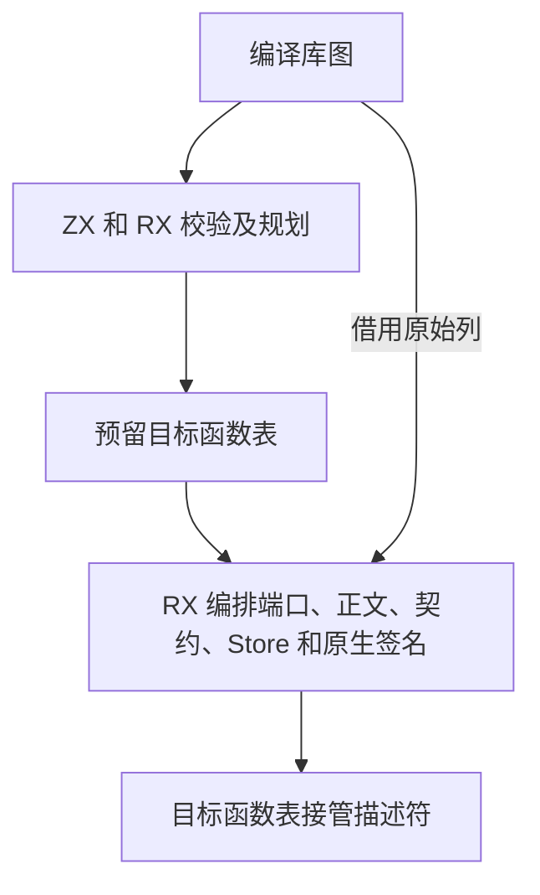
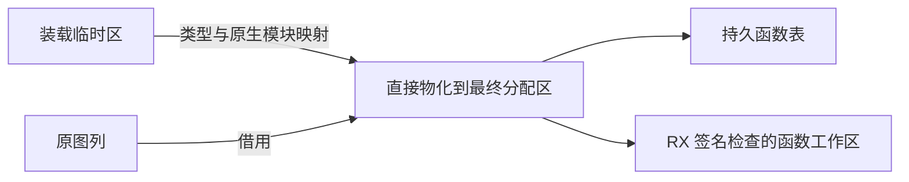

# 编译库函数直接发布

## Intent

让编译库装载中的函数编号重映射、名称改写和正文物化共用一次 RX/ZX 调用，在最终函数分配区内生成结果。公开接口仍按原选择顺序发布，RX 签名检查仍使用独立的函数工作区。

## Data

原装载先遍历整个函数表，在临时区中改写函数标识和 Store 路径、重映射符号与表达式的类型及调用编号，随后将已映射的列和文本复制到最终 allocator。发布时临时列与持久列同时存在。修改后规划只保留类型和原生模块映射，批量预留函数表容量，每个函数从原图借用输入列，按最终 allocator 执行 RX 的重映射和物化步骤，生成结果描述符直接由函数表接管。

## Edges

函数重映射使用开始发布前的固定基址，调用 ID 不随逐行提交变化。库图的有效性、公共入口的选择和函数索引容量在提交之前检查。函数追加失败仍沿用调用方的分配区清理契约。类型与原生模块的装载计划及公开接口记录还经过临时区，本阶段完成函数发布路径。

## Answer

15 组库和原生链接回归通过，共 94 项，覆盖编译库装载、释放输入图后的所有权、内存分配失败、原生模块和 Store。安装版 47 项检查和 6 组导入结果对照通过。原生模块夹具的 20 个源码发布文件、21 个编译库再发布文件均与上一阶段逐字节相同。该夹具编译库再发布的墙钟和 CPU 中位数分别维持在 0.02 秒和 0.01 秒，单进程峰值中位数从 13.07 MB 降至 12.93 MB。

上一阶段 Source 工具生成本阶段第一代，之后每代工具生成下一代。三代均使用 Source 分析与生成，五组生成目录的 11,189 个输出文件逐字节一致。

整仓冷构建使用 Zig 0.17.0、ReleaseSmall、12 核，重新构建 Native seed 后生成并安装使用 Source 分析和生成实现的工具。各轮使用独立的 Zig 本地和全局缓存。以下内存数值为进程树合计与单进程的采样峰值。

| 样本       | 墙钟（秒） | CPU（秒） | 树峰值（MB） | 单进程峰值（MB） |
| ---------- | ---------: | --------: | -----------: | ---------------: |
| 固定基线   |     117.82 |    207.44 |      2328.74 |          2087.88 |
| 上一阶段   |     112.94 |    204.83 |      2315.09 |          2129.77 |
| 本阶段复测 |     113.81 |    206.19 |      2347.19 |          2130.15 |

本阶段墙钟变化 +0.87 秒，CPU 变化 +1.36 秒（+0.66%）。相对固定基线，墙钟减少 4.01 秒，CPU 减少 1.25 秒。树峰值增加 32.10 MB，采样峰值落在三个并发的 LLVM 分区进程，单进程峰值增加 0.38 MB。固定基线以来树峰值增加 18.45 MB，单进程峰值增加 42.27 MB。

第一次冷构建墙钟 118.81 秒、CPU 210.64 秒，磁盘可用空间一度约 142 MiB，生成写入从上阶段的 325 ms 增到 1794 ms。结束废弃的磁盘统计并清理旧 Zig 缓存后复测，写入回到 319 ms，两次构建的四个 LLVM 分区目标文件逐字节一致。
