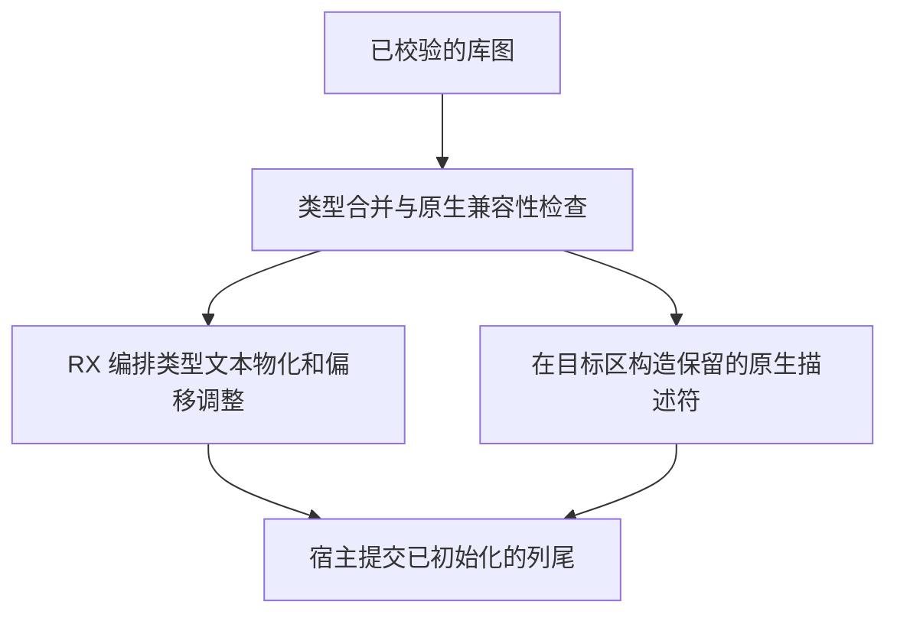

# 编译库类型与原生模块发布

## Intent

由 RX 编排类型增量中各文本列的所有权和行偏移调整，直接写入宿主预留的列尾。编译库原生模块继续按原顺序做兼容性校验，类型编号和借用的描述符在最终分配区物化。

## Data

类型增量此前由 Zig 复制三列类型文本及两列名义类型文本，再调用 ZX 调整偏移。现在 ZX 逐列调用标准库的批量文本复制，保留一个列级回收进度。原生模块规划此前映射新条目的类型编号，发布时再次复制该列。现在兼容性检查对既有条目按目标编号比较，对本轮候选从原图编号查询映射。发布入口将新条目的编号直接写入目标分配区。

## Edges

类型列在全部成功前不增加可见长度。标准库回收当前列的部分复制，宿主回收已完成的列。原生模块还需用改写后的名称匹配目标表或先前条目，相关名称由临时计划持有到发布。Zig 保留容量管理、错误清理和公开结构的物理写入。

## Answer

整仓冷构建以 Zig 0.17.0、ReleaseSmall、12 核和独立本地及全局缓存执行。重新构建 Native seed 后生成并安装使用 Source 分析与生成的工具。

| 样本     | 墙钟（秒） | CPU（秒） | 树峰值（MB） | 单进程峰值（MB） |
| -------- | ---------: | --------: | -----------: | ---------------: |
| 固定基线 |     117.82 |    207.44 |      2328.74 |          2087.88 |
| 上一阶段 |     111.49 |    204.06 |      2348.30 |          2133.10 |
| 本阶段   |     111.18 |    203.92 |      2314.76 |          2137.15 |

本阶段墙钟减少 0.31 秒，CPU 减少 0.14 秒，进程树峰值下降 33.54 MB，单进程峰值增加 4.05 MB。相对固定基线，墙钟减少 6.64 秒，CPU 减少 3.52 秒，进程树峰值下降 13.98 MB，单进程峰值增加 49.27 MB。生成器推导、生成及写入分别用时 707、740 和 348 毫秒。

原生夹具的 20 个源码发布文件与 21 个编译库再发布文件均逐字节一致。编译库再发布前后墙钟中位数均为 0.01 秒，进程峰值中位数由 13.06 MB 降至 12.94 MB。

23 组 145 项库、语义缓存和链接回归通过，包含原生冲突拒绝后目标表不变及分配失败清理。47 项安装版检查和 6 组导入对照通过。旧 Source 工具的内嵌标准库接口缺少新增原语，因此从当前 Native seed 构建第一代，再连续三次用 Source 工具生成下一代。这三次 Source 生成的 11,208 个文件逐字节一致。
