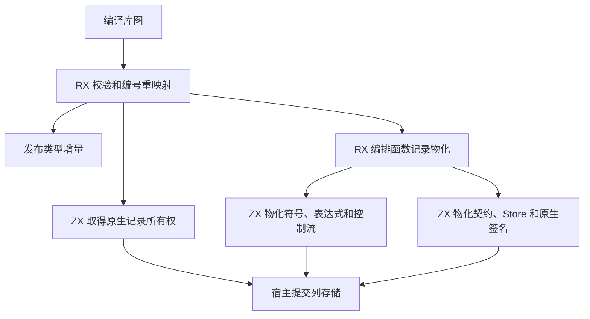
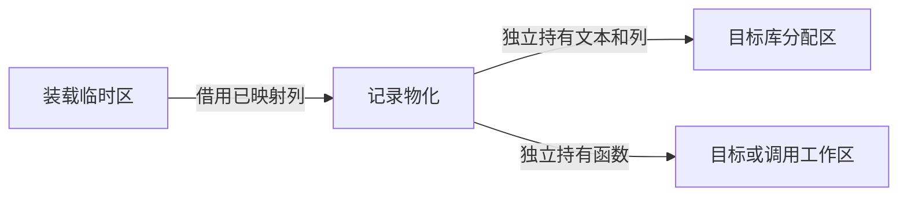

# 编译库装载记录所有权

## Intent

把编译库装载后的函数正文和原生模块所有权迁入 RX/ZX。装载临时区销毁后，类型及原生模块留在目标区，函数保留在调用方选定的区。用于 RX 签名检查的函数可随工作区释放。

## Data

库装载先校验输入并重映射编号，在临时区生成发布结果。此前 Zig 再逐列复制函数、契约、控制流和原生模块。工件发布上阶段已经提供按原长度复制的通用操作，并具有直接接管已归属目标区的列的能力。本阶段复用这些物化函数。缺少可以接管的列时，按原长度浅复制标量列，字符串列取得独立字节存储。

## Edges

装载时的类型和函数映射仍在临时区生成。要消除这部分映射列的再次复制，需要让映射步骤直接在相应目标分配区生成可接管的结果。宿主还负责列存储提交、导出别名记录共享，以及函数输入输出端口和原生标志的 ABI 转接。本阶段只修改装载的函数和原生记录所有权。

## Answer

以已有编译库装载、解码后重链接、Store 初始化器、原生函数 ABI 和分配失败检查验收。核对普通库与原生依赖库的生成产物，按相同工具链和输入口径核对冷构建及 Source 三代产物。

94 项 Zig 回归、47 项安装版检查和六组导入对照通过。库编解码测试第一次缺少测试脚本的 `type_column_fixture` 依赖，补齐后 26 项通过。源码发布和编译库重新发布的 20 与 21 份产物分别逐字节一致。重新发布在交替运行的三轮中，前后墙钟和 CPU 中位数均为 0.02 秒，RSS 中位数为 12.93 → 12.89 MB。

使用上一阶段 Source 第 5 个构建产物引导本轮，连续三代通过 22 步。两组相邻代各有 11,188 份生成产物逐字节一致。生成的 `executeValue` 借用输入列，目标函数表接管五份物化好的表描述符，避免通过宿主再分配描述符。Store 权限列继续使用原类型，由 `slice()` 批量复制。

整仓冷构建在同一目录使用 Zig 0.17.0、ReleaseSmall、12 个并发槽及四个 LLVM 分区。工具本体由 Native seed 引导，安装版运行 Source。

| 版本                | 墙钟（秒） | CPU（秒） | 进程树峰值 RSS（MB） | 单进程峰值 RSS（MB） |
| ------------------- | ---------: | --------: | -------------------: | -------------------: |
| 固定基线            |     117.82 |    207.44 |             2,328.74 |             2,087.88 |
| 上一阶段 `73e8be60` |     112.16 |    203.47 |             2,262.60 |             2,118.50 |
| 初版                |     111.28 |    203.54 |             2,342.78 |             2,135.46 |
| 接管描述符后        |     115.16 |    203.51 |             2,383.35 |             2,154.25 |
| 接管描述符后复测    |     114.83 |    205.34 |             2,358.74 |             2,150.20 |
| 上一阶段同期对照    |     113.75 |    204.51 |             2,331.15 |             2,141.09 |
| 同期候选            |     112.94 |    204.83 |             2,315.09 |             2,129.77 |

两轮候选均通过 70 步。第二轮的 Zig 编译步骤整体推迟约 3.8 秒。生成阶段推导、输出与写入合计分别为 1.76 与 1.77 秒，最终 Zig 宿主库的采样墙钟分别为 33.35 与 33.27 秒。第二轮树峰与 489.10 MB 的 Zig 测试编译重叠。LLVM 分区合计峰值为 2,234.07 → 2,239.82 → 2,280.82 MB。

复测的四个 LLVM 分区对象与接管描述符后首次测量逐字节一致。同期对照的四个对象与上一阶段逐字节一致。复测较同期对照多 1.08 秒墙钟和 0.83 秒 CPU。复测与同期对照的 LLVM 分区合计峰值分别是 2,301.46 与 2,302.64 MB。复测树峰时有约 425 MB 的 Zig 测试编译与 LLVM 分区重叠。

紧接对照运行的候选通过 70 步，四个分区对象与此前最终候选逐字节一致。较同期对照，墙钟减少 0.81 秒，CPU 增加 0.32 秒，进程树峰值和单进程峰值分别下降 16.06 和 11.32 MB，LLVM 分区合计峰值下降 16.06 MB。较历史上一阶段记录，墙钟、CPU 分别增加 0.78 和 1.36 秒，树峰增加 52.49 MB。相对固定基线，墙钟减少 4.88 秒，CPU 减少 2.61 秒，树峰下降 13.65 MB，单进程峰值仍高 41.89 MB。
