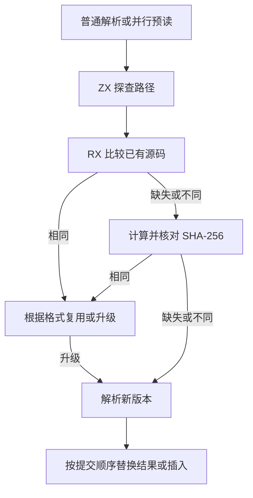
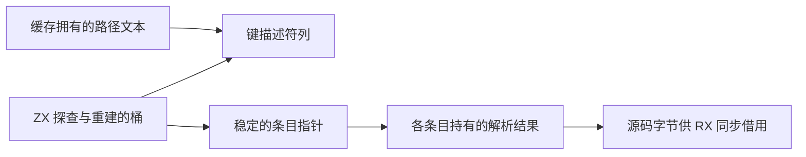

# 解析缓存索引与版本判定

## Intent

让解析缓存与语义缓存共用 ZX 的路径索引实现，并由 RX 决定何时复用、升级解析格式或重新解析。保留并行预读的工作方式和缓存结果的借用期限。

## Data

解析缓存原先在 Zig 中查找路径和比较源码字节，再调用 RX 处理摘要与格式。现在普通解析和并行预读都使用语义缓存已验证过的 ZX 路径探查和扩容重建。RX 直接借用候选源码和已有源码，先比较字节，必要时再计算 SHA-256 并核对已有摘要。普通解析的首次查找会保留空槽，插入时只有扩容才重新探查。

## Edges

Zig 继续管理线程调度、结果所有权和物理提交。并行阶段只读索引，结果按请求次序提交，因而会在串行提交时重新探查。索引扩容只移动描述符和条目指针。已有解析树及其源码字节仍由各结果持有。兼容格式升级沿用原摘要。无法提供源码文本的错误结果继续通过摘要复用。

## Answer

38 组 234 项 Zig 回归与 47 项安装版检查通过。临时探针覆盖 129 个条目的并行预读、多次扩容、解析格式升级、无源码文本的错误结果复用及延迟回收。三代 Source 自编译各通过 22 步，两组相邻代各有 11,233 份生成产物逐字节一致。首次冷构建采样因磁盘空间耗尽中断，释放已验收阶段可重建的本地 Zig 缓存后重新执行。

整仓冷构建使用 Zig 0.17.0、ReleaseSmall、12 核、四个 LLVM 分区和独立空缓存。Native seed 引导安装版，安装版执行 Source 分析和生成。候选构建通过 70 步。

| 样本               | 墙钟（秒） | CPU（秒） | 进程树峰值（MB） | 单进程峰值（MB） |
| ------------------ | ---------: | --------: | ---------------: | ---------------: |
| 固定基线           |     117.82 |    207.44 |          2328.74 |          2087.88 |
| 上一阶段两轮中位数 |     114.22 |    204.03 |          2319.53 |          2140.21 |
| 上一阶段同期对照   |     113.13 |    205.15 |          2357.33 |          2150.84 |
| 候选               |     112.16 |    205.17 |          2358.87 |          2153.30 |

较同期对照，候选墙钟减少 0.97 秒，CPU 增加 0.02 秒，两项峰值分别增加 1.54 MB 和 2.46 MB。四个 LLVM 分区同时采样的合计峰值由 2,328.69 MB 降至 2,323.33 MB。相比固定基线，墙钟少 5.66 秒、CPU 少 2.27 秒，两项内存峰值分别高 30.13 MB 和 65.42 MB。同期对照四个分区对象与上一版的历史产物逐字节一致。

1,027 模块的冷生成墙钟中位数保持 0.56 秒，CPU 从 0.58 秒变为 0.59 秒。全量热恢复的墙钟和 CPU 中位数保持 0.42 秒与 0.45 秒，持久缓存负载一致。编辑和还原叶子各重分析 1 个模块并复用 1,026 个，输出与独立冷生成逐字节相同。

使用相同构建口径的生成分区单测进程内热路径。4,096 个条目预热后，执行 40 轮只读预读加逐项访问，七轮交替的中位数由 10.45 ms 升至 11.52 ms。共 327,680 次索引查询，每次平均多约 3 ns。两版均只解析 4,096 个条目。进程峰值中位数从 24.76 MB 到 24.82 MB。该微基准的相对增幅为 10.2%，绝对差额为 1.07 ms。命中时的索引调用边界仍是后续优化点。
