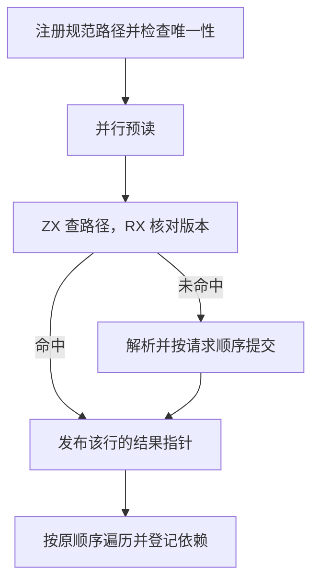

# 解析预读与源码图交接

## Intent

消除解析缓存热路径中，源码图预读完成后再次查找同一条目和比较源码的工作。保留 RX 版本判定、ZX 索引以及源码图原有的遍历和诊断顺序。

## Data

源码图注册时已经保证规范路径唯一，预读也已经核对每份输入的版本。此前遍历仍按路径调用普通解析入口。现在预读按源码行号同步交付已验证的解析结果。命中时工作线程写入缓存中稳定的结果指针，未命中时主线程在提交解析结果时填入指针。源码图在本次遍历内直接借用这些结果。

预读工作线程原来为每个请求抢占一次同一计数器。现在按批领取，并结合请求数和核心数调整批大小，最多一次领取 16 条。小批次仍能让足够多的工作线程参与。交接数组和请求数组使用可释放的临时分配器。

## Edges

交接入口只接受路径唯一的批次，沿用普通缓存查询的借用期限。原预读入口继续支持一般批次。图遍历期间没有缓存替换。错误诊断仍在遍历到对应模块时产生，缓存命中计数继续只统计实际访问的模块。线程调度、提交和结果生命周期仍由 Zig 执行。

## Answer

38 组 234 项 Zig 回归和 47 项安装版检查通过。并行预读专项确认 129 个结果按顺序交付，覆盖多次扩容、格式升级、替换、诊断和延迟回收。三代 Source 自编译各通过 22 步，两组相邻代各有 11,233 份生成文件逐字节一致。

整仓冷构建使用 Zig 0.17.0、ReleaseSmall、12 核、四个 LLVM 分区和独立空缓存。Native seed 引导安装版，安装版执行 Source 分析和生成。本阶段完整构建通过 70 步。四个 LLVM 分区对象与上一阶段的历史样本逐字节相同。

| 样本             | 墙钟（秒） | CPU（秒） | 进程树峰值（MB） | 单进程峰值（MB） |
| ---------------- | ---------: | --------: | ---------------: | ---------------: |
| 固定基线         |     117.82 |    207.44 |          2328.74 |          2087.88 |
| 上一阶段历史样本 |     112.16 |    205.17 |          2358.87 |          2153.30 |
| 上一阶段同期对照 |     112.17 |    205.30 |          2372.34 |          2145.09 |
| 首轮             |     114.25 |    202.42 |          2336.28 |          2130.35 |
| 确认轮           |     112.19 |    205.00 |          2355.63 |          2146.93 |

首轮的 LLVM 分区比上一阶段历史样本晚约 2.20 秒启动。同期对照和确认轮的 LLVM 分区在同一采样时间结束。确认轮较同期对照墙钟多 0.02 秒、CPU 少 0.30 秒。进程树峰值少 16.71 MB，单进程峰值多 1.84 MB。相对固定基线，确认轮墙钟少 5.63 秒、CPU 少 2.44 秒，进程树和单进程峰值仍分别高 26.89 MB 和 59.05 MB。

以 4,096 个缓存条目预热，分别执行 40 轮预读和读取，七轮交错运行。上阶段中位数为 11.45 ms，仅改为成批领取时为 8.03 ms，直接借用预读结果后为 3.10 ms。测试进程峰值中位数从 24.79 MB 到 26.08 MB，临时指针列与请求数组在源码图扫描结束前释放。

1,027 模块冷生成的墙钟和 CPU 中位数保持 0.57 秒、0.59 秒。全量热恢复墙钟从 0.43 秒降至 0.42 秒，CPU 从 0.45 秒到 0.46 秒，RSS 从 50.40 MB 到 52.46 MB。编辑和还原叶子各重分析一个模块，复用 1,026 个，输出与独立冷生成逐字节一致。
