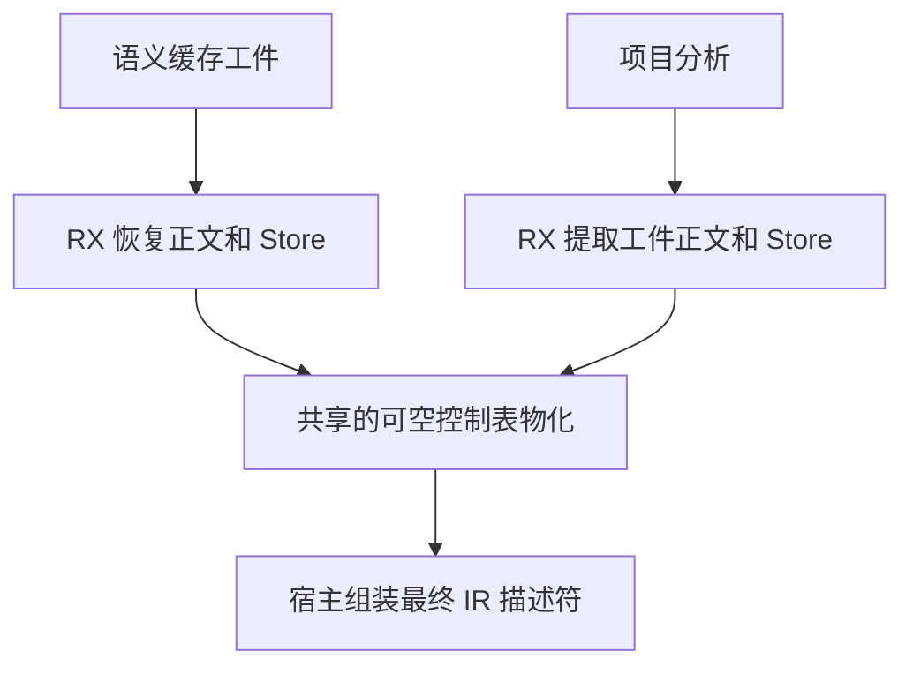

# 语义缓存与工件正文发布

## Intent

由 RX 编排工件提取和语义缓存恢复的正文物化。两条路径共用控制流复制，恢复的程序借用当前项目单元的稳定路径。

## Data

原先 RX 完成正文列和 Store 的映射，Zig 再启动独立的控制表复制。工件提取和缓存恢复已分别确认输入结构，因此可以在现有 RX 物化阶段调用控制列复制。恢复缓存通过规范路径选中条目，磁盘装载会核对预期路径。当前项目单元名称与恢复结果拥有同样的生命周期。

## Edges

磁盘条目继续在准入时经结构校验，进程内缓存和独立链接保持现有的控制结构检查。可空控制表沿用无根节点的语义。类型接口和常量映射继续复用工件声明发布。工件依赖准入规则仍拒绝待提取记录中的编译库依赖。

## Answer

33 组 209 项回归通过，覆盖工件提取、来源准入、库链接、语义缓存编解码和生命周期，以及分配失败。47 项安装版检查与六组导入对照通过。Source 三代的 11,210 个生成产物逐字节一致。

199 模块的热恢复保留全部 199 个命中，生成输出、持久缓存的模块负载和上下文摘要逐一相同。编辑一个叶子再恢复，两个版本均只重分析 1 个模块，复用 198 个，结果与独立冷生成一致。热恢复墙钟和 CPU 中位数均为 0.07 秒，进程峰值中位数从 18.69 MB 到 18.87 MB。Store 夹具通过生成产物对照。该 RX CLI 入口不输出语义缓存统计，因此不把其产物对照计作磁盘语义缓存命中证据。

整仓冷构建采用 Zig 0.17.0、ReleaseSmall、12 核及独立冷缓存。Native seed 生成安装版的 Source 分析与生成。候选两次测量的四个 LLVM 分区对象逐字节相同。上一提交的同期对照与其历史构建的四个对象也逐字节相同。

| 样本             | 墙钟（秒） | CPU（秒） | 树峰值（MB） | 单进程峰值（MB） | LLVM 分区合计峰值（MB） |
| ---------------- | ---------: | --------: | -----------: | ---------------: | ----------------------: |
| 固定基线         |     117.82 |    207.44 |      2328.74 |          2087.88 |                       — |
| 上一提交历史记录 |     111.18 |    203.92 |      2314.76 |          2137.15 |                 2265.87 |
| 上一提交同期对照 |     112.52 |    203.79 |      2333.44 |          2132.82 |                 2294.28 |
| 候选首次         |     112.69 |    202.39 |      2350.30 |          2128.51 |                 2321.73 |
| 候选复测         |     112.37 |    203.57 |      2379.83 |          2125.48 |                 2323.61 |

复测较同期对照墙钟减少 0.15 秒，CPU 减少 0.22 秒，单进程峰值下降 7.34 MB。树峰高 46.39 MB，峰值时有约 469 MB 的 Zig 测试编译与四个 LLVM 分区重叠。两次候选的 LLVM 分区合计峰值分别高 27.45 MB 和 29.33 MB。

按 PID 和分区根文件分开计算后，增长最大的分区 0 的全部 972 个生成文件与目标对象都逐字节相同，采样峰值由 907.21 MB 到 975.00 MB。公共类型文件增加 4,462 字节。三个目标对象发生变化的分区，按同一时刻累加的峰值由同期的 1,751.50 MB 降至两次候选的 1,686.80 MB 和 1,711.05 MB。整树差异保留在上表，当前证据未将其归因到正文发布代码。
