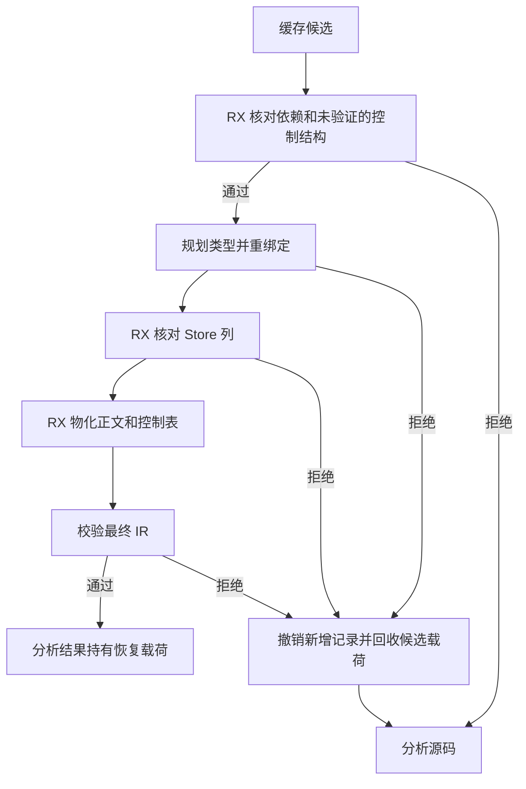
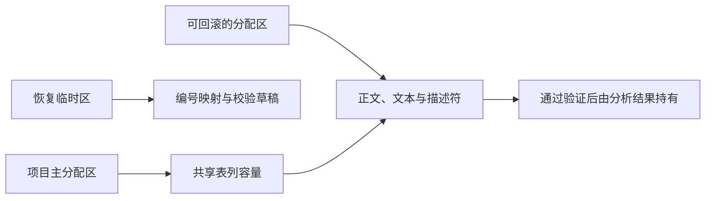

# 语义缓存恢复校验与内存回滚

## Intent

在恢复源码语义缓存时尽早拒绝无效的控制结构和 Store 列。候选在最终 IR 校验失败时，撤销本次恢复写入的项目记录并回收正文、类型文本和描述符占用的内存。此前成功恢复的模块继续有效。

## Data

旧实现恢复类型和名义来源的行数后，候选正文的分配仍留在项目 arena，直到整个项目分析结束。项目共享表会扩容，回滚时须保留扩容后的列容量。此次将共享表列与候选载荷分开分配。RX 在依赖核对的最后一批检查未经证明的控制结构，并在正文物化前核对 Store 列。候选成功时将载荷的分配区转给分析结果。候选失败时撤销新增记录，将载荷分配区恢复到当前候选开始前的状态。

## Edges

磁盘缓存已有的结构证明继续复用。候选失败时先移除递归函数行并恢复类型和名义来源长度，再回收候选载荷。候选不缩减已经分配的共享列容量。分配失败继续向调用者传播。源码回退调度及共享表的物理提交仍由 Zig 执行。

## Answer

临时探针保留递归入口缓存的编译器标识并重新计算负载摘要，只改动一条正文结果引用。两版均从磁盘载入两份工件，复用有效依赖，回退时只重分析入口，生成结果与独立冷生成逐字节相同。修复后的磁盘条目再次全量命中。

进程内探针使用可跟踪的底层分配器。为一个正文候选加入 4 MiB 的名称，并令其结果引用无效。恢复期间，单笔至少 4 MiB 的分配同时占用最多 10,485,794 字节。分析返回时此类分配存量为零，且有效的依赖仍然命中，回退后 IR 校验通过。

无并发构建时，对 1,027 模块工程交替比较。两版全量热命中，墙钟中位数均为 0.42 秒，CPU 中位数从 0.45 秒降至 0.44 秒，RSS 中位数从 58.03 MB 降至 50.50 MB。冷生成墙钟和 CPU 中位数均分别为 0.55 秒和 0.58 秒。持久缓存负载一致。修改和还原叶子各重分析一个模块并复用 1,026 个，产物与独立冷生成逐字节一致。

35 组 220 项 Zig 回归与 47 项安装版检查通过。三代 Source 自编译各通过 22 步，两组相邻代各有 11,224 份生成产物逐字节一致。

整仓冷构建使用 Zig 0.17.0、ReleaseSmall、12 核、四个 LLVM 分区和独立空缓存。Native seed 引导安装版，安装版执行 Source 分析和生成。构建通过 70 步。

| 样本     | 墙钟（秒） | CPU（秒） | 进程树峰值（MB） | 单进程峰值（MB） |
| -------- | ---------: | --------: | ---------------: | ---------------: |
| 固定基线 |     117.82 |    207.44 |          2328.74 |          2087.88 |
| 上一阶段 |     111.95 |    203.32 |          2343.04 |          2141.62 |
| 本阶段   |     111.13 |    203.57 |          2343.93 |          2153.71 |

本阶段冷构建墙钟减少 0.82 秒，CPU 增加 0.25 秒，进程树峰值增加 0.89 MB，单进程峰值增加 12.09 MB。相对固定基线，墙钟减少 6.69 秒，CPU 减少 3.87 秒。进程树峰值和单进程峰值分别高 15.19 MB 和 65.83 MB。

四个 LLVM 分区同时采样的合计峰值由 2,263.45 MB 到 2,315.35 MB。两轮单进程峰值均来自 Zig 宿主库构建。完整冷构建的生成器没有语义缓存命中，回收效果由单独的恢复对照和失败探针验证。
