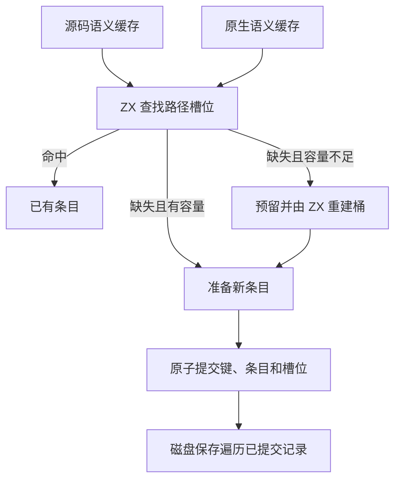
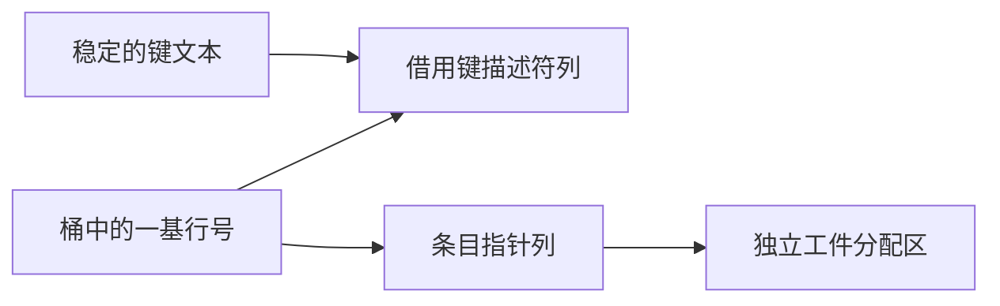

# 语义缓存条目索引

## Intent

由 ZX 实现源码和原生语义缓存共用的路径索引查找及重建。保留条目的准备、提交和失败清理顺序，以及磁盘缓存的文件格式和版本规则。

## Data

两类缓存此前共用 Zig 字符串哈希表。改用核心包的固定槽位探查规则，扩容时 ZX 从借用的键列重建桶。记录与键均在独立存储中，桶只保存行号。新条目保留第一次查找的空槽，只有扩容才重新定位。磁盘保存直接遍历已提交的行。

## Edges

桶重建和查找复用原有固定索引的字节比较、散列和线性探查。载荷达到四分之三时扩容。Zig 继续持有可释放的列和工件，条目替换仅更新已有指针指向的内容。写盘遍历按照插入顺序，文件键、负载和磁盘命中规则保持一致。依赖帧以及缓存失败后的分析调度仍由项目宿主执行。

## Answer

验证两类缓存的查找、持久化往返、分配失败、版本失效和结果生命周期。用多模块工程覆盖多次扩容，并对比热命中、编辑恢复、输出和缓存负载。完整自举验证沿用三代 Source 产物对照及整仓冷构建。

使用 1,027 个源码模块覆盖多次索引扩容。两版分别写出 1,027 份同样的负载，文件路径、上下文摘要与生成输出一致。热恢复全量命中。编辑和还原叶子模块各重分析一个模块、复用 1,026 个，输出与独立冷生成逐字节一致。

| 1,027 模块的中位数 | 上一版墙钟（秒） | 本版墙钟（秒） | 上一版 CPU（秒） | 本版 CPU（秒） | 上一版 RSS（MB） | 本版 RSS（MB） |
| ------------------ | ---------------: | -------------: | ---------------: | -------------: | ---------------: | -------------: |
| 冷生成             |             0.55 |           0.55 |             0.58 |           0.57 |           109.89 |         109.59 |
| 恢复               |             0.41 |           0.42 |             0.45 |           0.45 |            57.97 |          58.69 |

整仓冷构建使用 Zig 0.17.0、ReleaseSmall、12 核和四个 LLVM 分区。每轮使用独立的空本地及全局缓存，Native seed 引导运行 Source 分析与生成的安装版。

| 样本     | 墙钟（秒） | CPU（秒） | 进程树峰值（MB） | 单进程峰值（MB） |
| -------- | ---------: | --------: | ---------------: | ---------------: |
| 固定基线 |     117.82 |    207.44 |          2328.74 |          2087.88 |
| 上一阶段 |     113.30 |    205.65 |          2351.43 |          2126.76 |
| 本阶段   |     112.10 |    204.90 |          2341.29 |          2128.31 |

较上一阶段，墙钟减少 1.20 秒，CPU 减少 0.75 秒，树峰下降 10.14 MB，单进程峰增加 1.55 MB。较固定基线，墙钟和 CPU 分别减少 5.72 秒及 2.54 秒，树峰和单进程峰分别高 12.55 MB 和 40.43 MB。

候选 LLVM 分区同时采样的合计峰值为 2307.10 MB，上一阶段为 2322.84 MB。候选进程树峰值在四个分区与一个 447.02 MB 的 Zig 测试编译进程重叠时取得。

35 组 220 项 Zig 回归和 48 项安装版检查通过，覆盖源码缓存分配失败、持久缓存损坏拒绝、原生生成复用和声明顺序变更。递归缓存对照结果一致。以前一阶段 Source 第 3 代引导，本轮三代均通过 22 步，两组相邻代各有 11,223 份产物逐字节一致。
