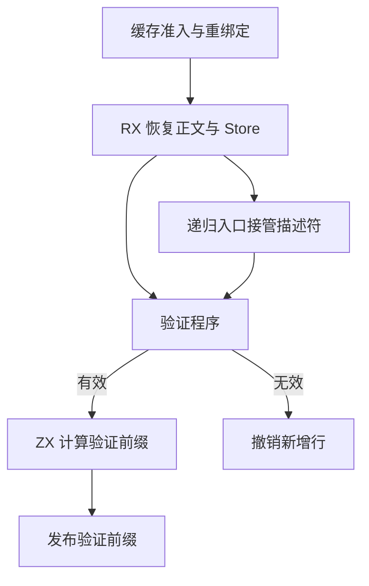
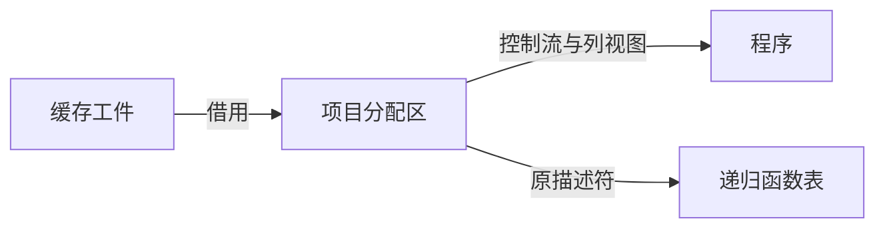

# 语义缓存递归入口发布

## Intent

在缓存恢复阶段把递归入口所需的已物化描述符交给项目函数表。IR 验证由 RX 编排，验证成功后由 ZX 从本次检查过的函数和类型列计算下一次可复用的验证前缀。

## Data

恢复入口的符号、表达式、Store 和契约列已在项目分配区生成。此前宿主将列看作值组装程序，递归函数入表时又为四张表复制描述符。现在函数表直接接管四个描述符，回滚使用现有的行移除接口。验证前缀由成功验证的输入构建，宿主读取值入口的返回值并发布。

## Edges

项目宿主仍管理表的容量与提交。恢复失败时撤销新增函数行并恢复类型及名义来源长度。普通入口和递归入口的 ID 保持原分配顺序。旧 Native seed 仍使用其现有恢复路径。

## Answer

33 组 209 项回归及 47 项安装版检查通过。以前一阶段的 Source 工具引导，三代均完成 22 个构建步骤，11,214 个生成文件逐字节一致。首轮宿主编译发现新入口使用值 ABI，改用通用列借用调用后通过。

带导入常量的递归入口在两版中均热恢复 3 个模块。改动并恢复常量时各重分析 2 个模块、复用 1 个模块，输出与独立冷生成逐字节一致。199 模块对照中，冷热生成的产物及持久缓存负载一致。热恢复墙钟和 CPU 中位数均为 0.07 秒，进程峰值中位数由 18.66 MB 到 18.76 MB。生成的 `executeValue` 边界直接返回前缀值，未插入堆分配。

整仓冷构建使用 Zig 0.17.0、ReleaseSmall、12 核和独立的冷缓存。Native seed 为安装版生成 Source 分析与生成代码。

| 样本         | 墙钟（秒） | CPU（秒） | 树峰值（MB） | 单进程峰值（MB） |
| ------------ | ---------: | --------: | -----------: | ---------------: |
| 固定基线     |     117.82 |    207.44 |      2328.74 |          2087.88 |
| 上一阶段复测 |     112.37 |    203.57 |      2379.83 |          2125.48 |
| 本阶段       |     112.51 |    202.65 |      2295.68 |          2122.51 |

较上一阶段复测，墙钟增加 0.14 秒，CPU 减少 0.92 秒，进程树峰值减少 84.15 MB，单进程峰值减少 2.97 MB。相对固定基线，墙钟减少 5.31 秒，CPU 减少 4.79 秒，进程树峰值减少 33.06 MB，单进程峰值增加 34.63 MB。
