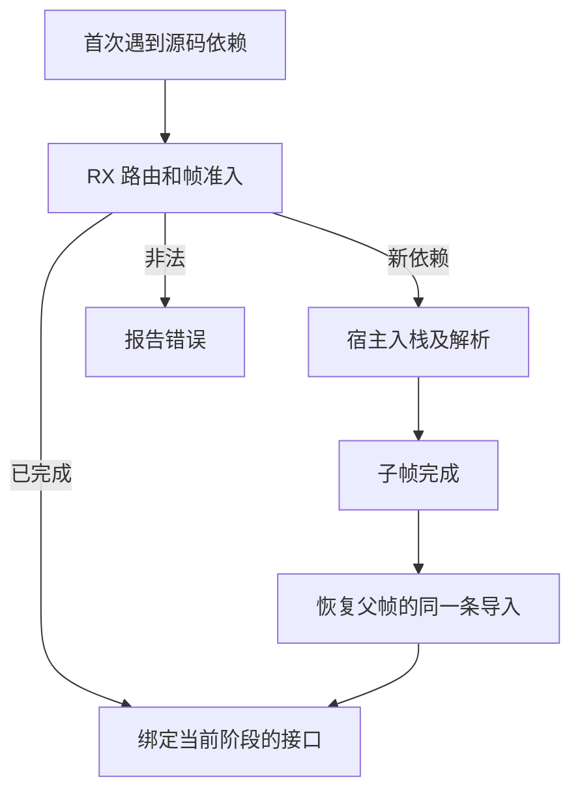
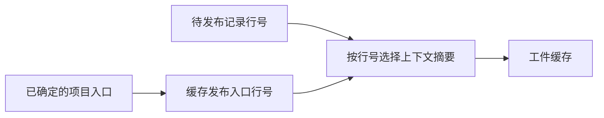

# 项目依赖帧准入

## Intent

让 RX 为首次遇到的源码依赖一次决定是否进入新帧、直接绑定、延迟签名或报错。依赖帧返回后沿已完成的子模块绑定，保持原来的深度优先和错误优先级。

## Data

此前 RX 返回进入子帧后，宿主还要对同一子模块重复调用准入。恢复父帧时，宿主已经持有完成的子模块编号，但还会重复执行源码目标分类。现在 RX 在解析源码目标后复用统一准入逻辑。循环和深度错误在进入帧前返回，恢复父帧直接借用已完成的签名或正文。缓存批量发布通过已经确定的入口记录编号选择上下文摘要，省去每条记录的路径比较。

## Edges

Zig 继续维护解析器、帧存储、导入的副作用和源码分析回退。诊断继续使用当前父帧的来源与原有跨度。已完成的模块在签名阶段与正文阶段各自借用对应接口。缓存发布继续在最终 IR 验证后执行。

## Answer

验收覆盖深度上限、未使用导入形成的环、共享依赖、重导出、语义缓存复用与增量回退，以及三代 Source 自编译。

199 模块缓存的路径、上下文摘要、负载和产物一致。两版均全量热命中，编辑及还原叶子各重分析一个模块并复用 198 个，输出与独立冷生成一致。冷生成墙钟与 CPU 中位数均为 0.11 秒。

整仓冷构建沿用 Zig 0.17.0、ReleaseSmall、12 核及四个 LLVM 分区。Native seed 引导安装版，运行 Source 分析与生成。前后构建使用各自的空本地和全局缓存。

| 样本     | 墙钟（秒） | CPU（秒） | 进程树峰值（MB） | 单进程峰值（MB） |
| -------- | ---------: | --------: | ---------------: | ---------------: |
| 固定基线 |     117.82 |    207.44 |          2328.74 |          2087.88 |
| 上一阶段 |     112.10 |    204.90 |          2341.29 |          2128.31 |
| 本阶段   |     111.95 |    203.32 |          2343.04 |          2141.62 |

较上一阶段，墙钟少 0.15 秒、CPU 少 1.58 秒。进程树峰值多 1.75 MB、单进程峰值多 13.31 MB。LLVM 分区同时采样的合计峰值由 2307.10 MB 降至 2263.45 MB。相对固定基线墙钟少 5.87 秒、CPU 少 4.12 秒，进程树峰值和单进程峰值仍分别高 14.30 MB 和 53.74 MB。

热恢复中位数墙钟从 0.10 秒降至 0.09 秒，CPU 保持 0.09 秒。ZX 与 RX 依赖循环、目录重导出、递归重导出、原生入口的输出或诊断与上一版一致。深链检查覆盖深度 255 与超限情形，并保留原有诊断跨度。

以前一阶段 Source 第 3 代引导，本轮三代均通过 22 步，两个相邻代各有 11,224 份生成产物逐字节一致。

36 组 227 项 Zig 回归与 47 项安装版检查通过。
