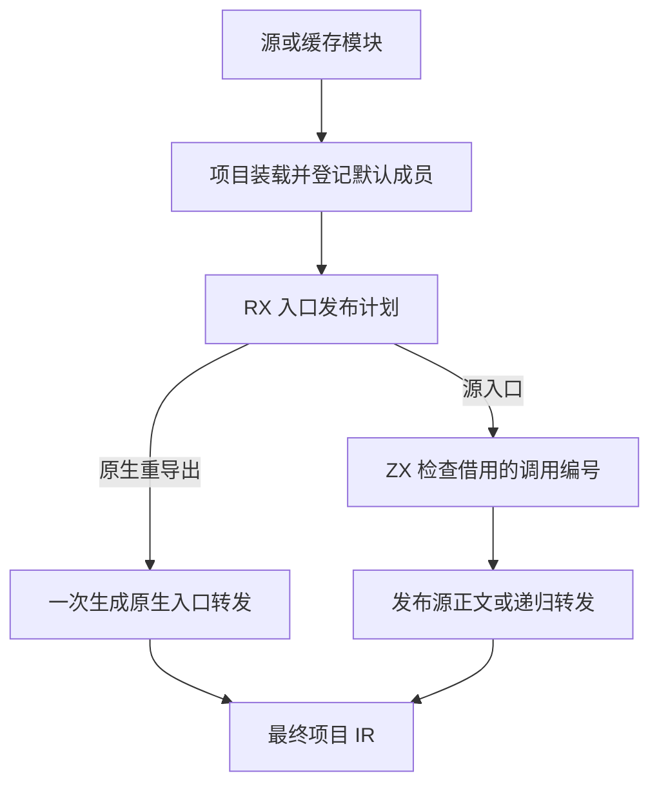

# 项目入口正文发布

## Intent

让项目入口发布由同一份 RX 计划决定采用哪个正文、是否生成转发，以及最终暴露的函数表范围。覆盖普通源入口、递归入口、默认重导出的源或原生入口，以及纯类型入口。

## Data

此前项目先在 Zig 中采用默认重导出的正文。原生入口先构造一次调用，递归检测从生成的调用中再次发现同一编号，再构造一次入口。现在宿主借用函数记录的原生模块字段和调用编号列，RX 对原生重导出直接返回转发计划，对源入口保留原有递归检测。宿主一次生成最终的入口调用，沿用原入口符号、表达式、控制流及契约处理结果。

## Edges

入口最终计划仍挂在原有公开生成入口。RX 下标要求 u64。独立复现确认，直接用 u32 作为数组下标会失败，而且同批多个 RX 入口时，类型冲突的位置有时落在另一模块。当前实现直接借用 Zig 列并在宿主取得原生标记，将正确类型的事实交给 RX，保留现有源语言的下标约定。诊断归属仍待单独修复。

依赖帧调度、缓存回退和函数表物理提交仍由 Zig 承担。

## Answer

验收覆盖默认源码重导出、递归重导出、有参和无参原生默认重导出、整仓独立冷构建和三代 Source 自编译。

同一批代码通过 35 组 220 项 Zig 回归与 47 项安装版检查。目录重导出、ZX 和 RX 消费、重复导出诊断、递归重导出及两组原生默认入口对照均逐字节一致。两版原生入口均生成独立可执行文件。递归缓存探针热恢复 3 个模块，编辑或恢复依赖常量时都分析 2 个、复用 1 个，输出与独立冷生成一致。

以前一阶段 Source 第 3 代工具引导，本轮连续三代均通过 22 步，两个相邻代各有 11,213 份产物逐字节一致。检查 Source 生成的 `executeValue` 及其调用链，计划直接返回栈上的值，递归检查借用调用编号的切片。原生入口只调用一次转发构造。

整仓冷构建使用 Zig 0.17.0、ReleaseSmall、12 核和四个 LLVM 分区。独立清空本地及全局缓存，Native seed 构建运行 Source 分析和生成的安装版。

| 样本             | 墙钟（秒） | CPU（秒） | 树峰值（MB） | 单进程峰值（MB） |
| ---------------- | ---------: | --------: | -----------: | ---------------: |
| 固定基线         |     117.82 |    207.44 |      2328.74 |          2087.88 |
| 上一阶段记录     |     111.70 |    203.35 |      2345.78 |          2129.33 |
| 上一提交同期对照 |     112.75 |    204.54 |      2343.70 |          2134.56 |
| 本阶段           |     113.30 |    205.65 |      2351.43 |          2126.76 |

候选相对同期对照墙钟多 0.55 秒，CPU 多 1.11 秒（0.54%），树峰值高 7.73 MB，单进程峰值低 7.80 MB。对照重跑的四个 LLVM 对象与上一阶段完全相同。候选与同期对照均在 LLVM 分区编译期间达到树峰，LLVM 合计峰值从 2314.98 MB 变为 2322.84 MB。候选前端推导和生成共 1444 毫秒，对照为 1443 毫秒。CPU 仍比固定基线少 1.79 秒，墙钟少 4.52 秒。固定基线以来，树峰和单进程峰分别增加 22.69 MB 和 38.88 MB。
