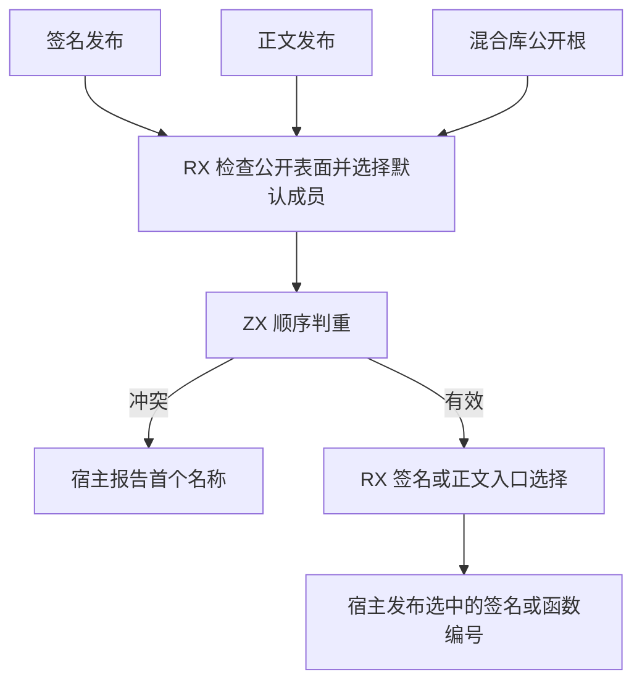

# 项目公开接口发布

## Intent

将项目签名与正文的公开名称检查、默认成员选择接到同一条 RX/ZX 发布链。保留直接入口、源码重导出、延迟签名、intrinsic 和原生入口的原有行为。

## Data

名称按类型、常量和函数的顺序检查，首次冲突决定诊断。空名称表示默认函数，混合编译库的公开根名称禁止为空。此前名称索引在 ZX 扫描中增长，存储名称、占位值和桶。现在复用固定字节索引，按记录总数预留桶，索引引用已有的名称描述符，不复制底层文本。

## Edges

现有 Zig 记录使用行存储，跨 ABI 仍采集一份借用的名称描述符。空表和普通无重导出模块沿用已有快速路径。宿主继续管理签名和 IR 表容量、提交记录、诊断及入口 IR 构造。依赖帧和缓存回退仍由项目宿主调度。

## Answer

验收覆盖签名与正文入口、公开名称冲突与默认重导出、原生及编译库导入、连续 Source 自编译和整仓冷构建。

整仓冷构建使用 Zig 0.17.0、ReleaseSmall、12 核和四个 LLVM 分区。每轮清空本地及全局缓存，由 Native seed 构建使用 Source 分析和生成的安装版。

| 样本     | 墙钟（秒） | CPU（秒） | 树峰值（MB） | 单进程峰值（MB） |
| -------- | ---------: | --------: | -----------: | ---------------: |
| 固定基线 |     117.82 |    207.44 |      2328.74 |          2087.88 |
| 上一阶段 |     112.51 |    202.65 |      2295.68 |          2122.51 |
| 本阶段   |     111.70 |    203.35 |      2345.78 |          2129.33 |

相比上一阶段，墙钟少 0.81 秒，CPU 多 0.70 秒。相比固定基线，墙钟少 6.12 秒，CPU 少 4.09 秒。进程树峰值比上一阶段高 50.10 MB，比固定基线高 17.04 MB。两次树峰均与 Zig 测试编译进程重叠，该进程在峰值点由 401.67 MB 升至 463.59 MB。LLVM 分区按同时采样累加的峰值从 2259.75 MB 降至 2252.60 MB。单进程峰值比上一阶段高 6.82 MB，比固定基线高 41.45 MB。

将入口正文选择接入生成清单时触发原生签名调用的类型推导错误。该入口仍沿用 Zig，签名与正文的默认成员选择使用本轮 RX 实现。错误发生在另一个模块的 RX 对象参数推导中，尚需最小复现定位。

35 组 220 项 Zig 回归和 47 项安装版检查通过。六组导入对照结果一致。额外对照覆盖目录默认重导出、由 ZX 和 RX 调用该默认入口，以及重复公开名称诊断，生成内容与诊断保持逐字节一致。三代 Source 自编译均通过 22 步，两组相邻代各有 11,213 份生成产物逐字节一致。
